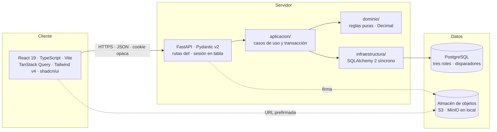
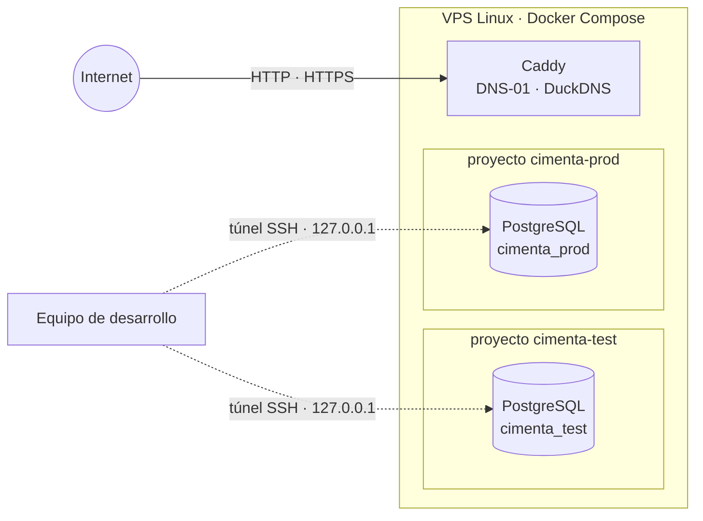
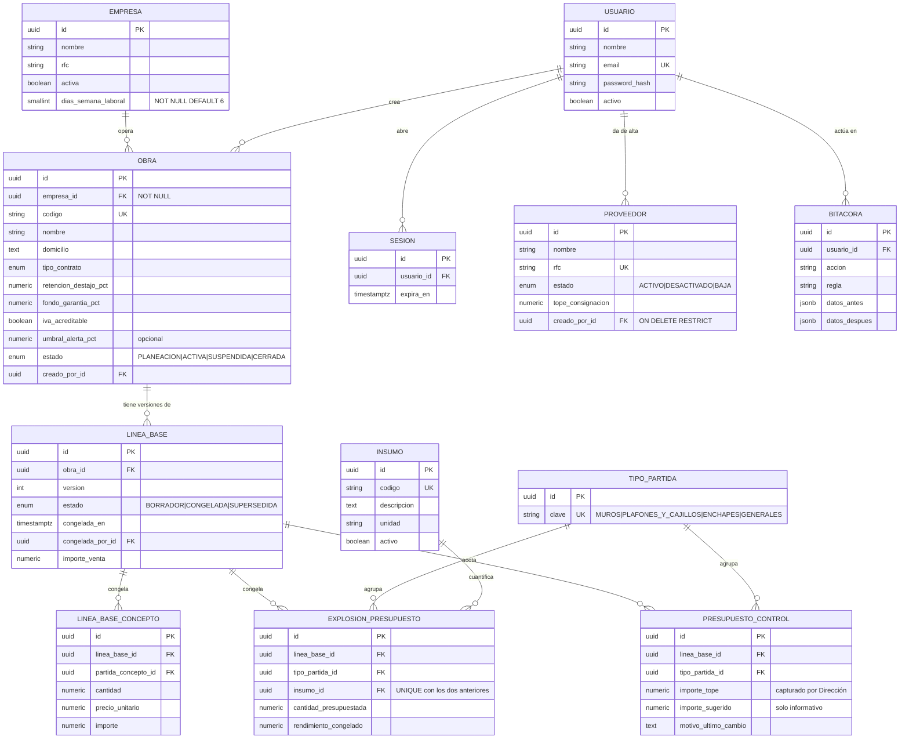

# CIMENTA

**Control Integral de Materiales, Estimaciones, Nómina y Tesorería de obra.**

> Proyecto Final — Máster IA4Devs (LIDR) · **Entrega 3**
> Rama de entrega: `final-project-JFRS`

## Índice

0. [Ficha del proyecto](#0-ficha-del-proyecto)
1. [Descripción general del producto](#1-descripción-general-del-producto)
2. [Arquitectura del sistema](#2-arquitectura-del-sistema)
3. [Modelo de datos](#3-modelo-de-datos)
4. [Especificación de la API](#4-especificación-de-la-api)
5. [Historias de usuario](#5-historias-de-usuario)
6. [Tickets de trabajo](#6-tickets-de-trabajo)
7. [Pull requests](#7-pull-requests)

**Documentación transversal**

| Documento | Qué contiene |
|---|---|
| [Glosario del dominio](docs/glosario.md) | Lenguaje ubicuo: *concepto*, *partida*, *destajo*, *explosión de insumos*, *rendimiento* |
| [Convenciones](docs/convenciones.md) | Docs-as-code, SDD, backlog AI-ready, ADRs, estimación |
| [Decisiones de arquitectura](docs/adr/README.md) | 47 ADRs en formato MADR |
| [Despliegue de prueba en VPS](docs/despliegue-prueba-vps.md) | Guía de operación de TKT-070 |
| [Arranque local](docs/arranque-local.md) | Requisitos, arranque del backend y del frontend, verificadores |
| [`prompts.md`](prompts.md) | Uso de IA a lo largo del proyecto: herramientas, prompts clave y criterio humano |
| [`CLAUDE.md`](CLAUDE.md) · [`AGENTS.md`](AGENTS.md) | Instrucciones de proyecto para el copiloto de IA |
| [`llms.txt`](llms.txt) | Mapa del proyecto para agentes de IA |

---

## 0. Ficha del proyecto

### **0.1. Tu nombre completo:**

**Juan Francisco Rodriguez Silva**

### **0.2. Nombre del proyecto:**

**CIMENTA** — plataforma SaaS de control de costos y operación de obra.

El nombre evoca *cimentar*: poner la base sobre la que se sostiene la obra. Es además un acrónimo de los dominios que gobierna: **C**ontrol **I**ntegral de **M**ateriales, **E**stimaciones, **N**ómina y **T**esorería de obr**A**.

### **0.3. Descripción breve del proyecto:**

CIMENTA controla el costo de obra de una constructora de tablaroca, plafones y acabados que trabaja a **precio alzado máximo garantizado**. En ese esquema el ingreso queda fijado desde la firma, así que el único margen que la empresa puede defender es el costo, y hoy ese costo vive en hojas de Excel y solo se conoce cuando ya se gastó.

El sistema congela el presupuesto de venta como **línea base inmutable**, deja que Dirección capture un **presupuesto de control** por obra y tipo de partida, y a partir de ahí hace que los límites **bloqueen** en lugar de advertir.

### **0.4. URL del proyecto:**

La aplicación **no está publicada en una URL todavía**. Lo que sí está en el servidor de pruebas de Database Mart es la base de datos del entorno `test`, migrada y con datos de demostración, detrás de un proxy inverso con HTTPS (véase [§2.4](#24-infraestructura-y-despliegue)). La imagen de la aplicación es el ticket TKT-058, aún sin hacer.

La evidencia de funcionamiento es el repositorio público, con un usuario de prueba (véase [§1.4](#14-instrucciones-de-instalación)), la suite de pruebas y el humo de Playwright, que recorren la aplicación de extremo a extremo.

### 0.5. URL o archivo comprimido del repositorio

<https://github.com/FranciscoRodSilva/IA4Devs-Proyecto-Final> · repositorio público · rama de la entrega: `final-project-JFRS`.

> `Doc de contexto/`, con la documentación original del cliente (nómina con nombres y salarios reales, precios unitarios de obras en curso), no se versiona: el repositorio es público y `RNF-07` lo prohíbe.

---

## 1. Descripción general del producto

### **1.1. Objetivo:**

Dar a la dirección de la constructora algo que hoy no existe: saber **durante** la obra si gana o pierde dinero, no después. El producto reemplaza el Excel disperso por un sistema que:

- guarda el presupuesto de venta como una referencia que nadie puede reescribir;
- compara cada gasto contra un tope por obra y tipo de partida;
- detiene lo que lo excede y registra quién lo autorizó y por qué.

Sirve a cinco roles: Dirección General, Director de Proyectos, Residente de obra, Compras, Almacén y Administración. El método con el que se construye, **Spec-Driven Development**, está en [`docs/convenciones.md`](docs/convenciones.md): la especificación precede al código y ningún criterio de aceptación cubre solo el camino feliz.

### **1.2. Características y funcionalidades principales:**

**Operativas hoy** (backend, base de datos y pantalla, con pruebas unitarias, de integración y de extremo a extremo):

| Funcionalidad | Qué hace | Tickets |
|---|---|---|
| **Inicio de sesión por rol** | Sesión con estado en el servidor (tabla `sesion`, cookie opaca), Argon2id, CSRF por doble envío, límite de intentos y cabeceras de seguridad. Armazón con la navegación de cada rol | TKT-006, TKT-008, TKT-057 |
| **Obras** | Alta, lista y consulta; edición, suspensión, reactivación, cierre y eliminación protegida de las obras sin historial. Código único, parámetros por obra (retención de destajo, fondo de garantía, IVA acreditable) | TKT-012a, TKT-012b |
| **Línea base y presupuesto de control** | Consulta de la línea base de una obra, congelado (`BORRADOR → CONGELADA`) y captura y recaptura, con motivo, del tope de control por tipo de partida. Solo Dirección General captura topes | TKT-017, TKT-018a |
| **Catálogo de proveedores** | Alta con RFC único, edición, desactivación y baja protegida: un proveedor con órdenes abiertas no se da de baja, y ninguno se borra | TKT-029a, TKT-029b, TKT-032a |

**Construidas en el backend, sin pantalla todavía:**

- **Importación del presupuesto desde Excel**: lector del catálogo de conceptos y de los análisis de precios unitarios (APU), análisis asíncrono con latido y barrido de arranque, y confirmación que materializa la jerarquía obra › nivel › área › partida (TKT-013 a TKT-017).
- **Explosión de insumos** por tipo de partida, con los tipos `Dinero`, `Cantidad`, `Rendimiento` y `Porcentaje`, que calculan con `Decimal` y solo redondean al cuantizar, con `ROUND_HALF_UP` (TKT-004, TKT-016).
- **Archivos con URL prefirmadas**: el servidor firma y se aparta; el tipo se lee de los bytes, nunca de la extensión (TKT-059).
- **Esquema del módulo de compras**: siete tablas con sus restricciones, disparadores y privilegios por rol (TKT-019).
- **Bitácora transaccional** de solo anexado.

**Lo que viene** (documentado y detallado, no construido): requisición con bloqueo por presupuesto (`RN-03`), resolución de bloqueos, órdenes de compra, entrada de material con recepción parcial y el semáforo de obra. La fase 2 trae nómina, destajo y captura sin conexión. El alcance completo está en [`docs/01-descripcion-producto.md`](docs/01-descripcion-producto.md).

### **1.3. Diseño y experiencia de usuario:**

Los bocetos de las diez pantallas del hilo vertical, con sus estados vacío, cargando, error y bloqueado, están en [`docs/08-wireframes.md`](docs/08-wireframes.md). Las pantallas construidas son:

| Pantalla | Ruta | Qué ve la persona |
|---|---|---|
| Inicio de sesión | `/` | Formulario con rechazo claro ante credenciales incorrectas y mensaje único, sin revelar si el correo existe |
| Armazón por rol | `/` tras entrar | Navegación según el rol; en teléfono, menú plegable |
| Obras | `/obras` | Tabla, alta en un formulario, acciones de estado y de eliminación con confirmación |
| Línea base | `/obras/:obraId/linea-base` | Conceptos, explosión, congelado con motivo y tabla del presupuesto de control con recaptura |
| Proveedores | `/proveedores` | Catálogo con alta, edición, desactivación y baja |

Recorrido sugerido: entrar como Compras, ver el armazón, cerrar sesión; entrar como Director de Proyectos, dar de alta una obra, congelar su línea base; entrar como Dirección General y capturar un tope de control.

### **1.4. Instrucciones de instalación:**

**Requisitos:** Git, [uv](https://docs.astral.sh/uv/), Node.js 24, Docker Desktop y Chromium o Firefox. Versiones y detalle en [`docs/arranque-local.md`](docs/arranque-local.md).

**1. Variables de entorno y base de datos.** Desde la raíz:

```bash
cp .env.example .env
docker compose up -d db
```

`.env.example` trae las credenciales del usuario de prueba y deja **vacías a propósito** las contraseñas de los tres roles de PostgreSQL y la de siembra. Genera cada una con `python -c "import secrets; print(secrets.token_urlsafe(24))"` y pégala en tu `.env`, que git ignora. La aplicación no arranca sin `CIMENTA_DB_CONTRASENA_APLICACION`.

**2. Backend, migraciones y roles.** Desde `backend/`:

```bash
uv sync --locked --python 3.14
uv run --env-file ../.env alembic upgrade head
uv run --env-file ../.env python -m herramientas.contrasenas_roles
```

**3. Sembrar datos de prueba.** Desde `backend/`. Las tres siembras se niegan a escribir si el host de la base no es local, y no sobrescriben lo que ya existe:

```bash
# Usuario de prueba manual (rol COMPRAS), con las credenciales de .env
PYTHONPATH=. uv run --env-file ../.env python ../frontend/e2e/sembrar_usuario_humo.py
# Un usuario por rol y 27 insumos con su precio, con la contraseña de CIMENTA_SEMILLA_CONTRASENA
uv run --env-file ../.env python -m herramientas.semilla_local
# Obra DEMO-018A con su línea base en BORRADOR; la última línea es OBRA_ID=<uuid>
uv run --env-file ../.env python -m herramientas.semilla_linea_base_local
```

En Windows PowerShell, el primero se escribe `$env:PYTHONPATH = "."; uv run --env-file ../.env python ../frontend/e2e/sembrar_usuario_humo.py`.

**4. API.** Desde `backend/`, en una terminal que se queda abierta:

```bash
uv run --env-file ../.env fastapi dev
```

Queda en `http://127.0.0.1:8000`; el contrato se publica en `/openapi.json`.

**5. Cliente.** Desde `frontend/`, en otra terminal:

```bash
npm ci
npm run dev
```

**6. Probar.** Abre **`http://localhost:5173`**, con `localhost` y no `127.0.0.1`: la cookie de sesión es `Secure` y solo Chromium y Firefox la aceptan en `http://localhost`.

| Credencial de prueba | Valor |
|---|---|
| Correo | `prueba.compras@cimenta.test` |
| Contraseña | `Cimenta-Prueba-2026` |
| Rol | `COMPRAS` |

Son credenciales de **prueba**: existen solo en la base local que crea el script de siembra, que rehúsa escribir en cualquier otro host. Los usuarios de `herramientas.semilla_local` entran como `<rol en minúsculas>@cimenta.test` con la contraseña de `CIMENTA_SEMILLA_CONTRASENA`: por ejemplo, `director_proyectos@cimenta.test` para dar de alta obras y congelar la línea base, y `direccion_general@cimenta.test` para capturar topes.

**Cómo verificar que funciona:**

1. Entra con las credenciales de prueba: aparece el armazón con la navegación de Compras.
2. Cierra sesión y entra con una contraseña incorrecta: el formulario rechaza sin revelar si el correo existe.
3. Entra como Director de Proyectos, abre `/obras` y da de alta una obra; repite el mismo código y comprueba el rechazo por código duplicado.
4. Abre `/obras/<OBRA_ID>/linea-base` con el `OBRA_ID` que imprimió la semilla y congela la línea base.
5. Entra como Dirección General y captura un tope de control; vuelve a capturarlo y comprueba que pide motivo.
6. En `/proveedores`, da de alta un proveedor y comprueba que el mismo RFC se rechaza.

---

## 2. Arquitectura del Sistema

### **2.1. Diagrama de arquitectura:**



**Patrón: monolito modular con capas por módulo.** Diez módulos (`identidad`, `auditoria`, `archivos`, `presupuesto`, `compras`, `almacen`, `avance`, `personal`, `proveedores`, `analitica`), cada uno con `api/`, `aplicacion/`, `dominio/` e `infraestructura/`. Un módulo solo habla con otro por su `interfaz.py` publicada.

**Por qué:** una empresa por despliegue ([ADR-008](docs/adr/20260918-despliegue-single-tenant.md)) y un equipo pequeño hacen innecesarios los microservicios. Las reglas de negocio, que son el valor del producto, viven en un `dominio/` sin dependencias, así que se prueban sin base de datos.

**Beneficios:** las fronteras las hace cumplir `import-linter` en cada pull request; el dominio es puro y rápido de probar; el esquema vive en el motor con 39 invariantes.

**Sacrificios:** más disciplina de capas que en un CRUD plano; SQLAlchemy síncrono limita la concurrencia por proceso, aunque es lo que permite razonar sin sorpresas ([ADR-013](docs/adr/20260919-sqlalchemy-sincrono.md)); la captura sin conexión se pospone a la fase 2.

### **2.2. Descripción de componentes principales:**

| Componente | Tecnología | Responsabilidad |
|---|---|---|
| Cliente web | React 19, TypeScript, Vite, TanStack Query y Table, Tailwind v4, shadcn/ui | Pantallas por rol. Los tipos se generan del OpenAPI y el dinero se maneja con `decimal.js`; el cliente nunca evalúa una regla |
| API | FastAPI, Pydantic v2 | Rutas `def` (nunca `async`), DTO, códigos de estado y contrato de error de siete tipos |
| Casos de uso | Python 3.14 | Abren la transacción, orquestan repositorios y escriben la bitácora en la misma transacción |
| Dominio | Python, solo biblioteca estándar y `tipos_base` | Reglas puras con `Decimal`: `Dinero`, `Cantidad`, `Rendimiento`, `Porcentaje` |
| Persistencia | SQLAlchemy 2 síncrono, Alembic, PostgreSQL | Esquema, migraciones reversibles, disparadores de inmutabilidad y tres roles: migración, aplicación y solo lectura |
| Archivos | MinIO (local), compatible con S3 | URL prefirmadas; el API no sirve ni guarda archivos |
| Observabilidad | structlog, Sentry | Registro estructurado con identificador de correlación dentro del contrato de error |

### **2.3. Descripción de alto nivel del proyecto y estructura de ficheros**

```text
.
├── backend/
│   ├── cimenta/<modulo>/{api,aplicacion,dominio,infraestructura}/ + interfaz.py
│   ├── tipos_base/       Dinero, Cantidad, Rendimiento, Porcentaje
│   ├── contrato_error/   las excepciones del contrato de error
│   ├── servidor/         fábrica de la aplicación y raíz de composición
│   ├── trabajos/         barrido genérico de filas vencidas
│   ├── migraciones/      Alembic · cadena 0001…0017
│   ├── herramientas/     siembras locales y verificadores propios
│   └── tests/            pytest + testcontainers (PostgreSQL real)
├── frontend/
│   ├── src/modulos/      una carpeta por módulo de negocio
│   ├── src/compartido/   componentes reutilizables
│   └── e2e/              Playwright
├── despliegue/           Compose y Caddy del servidor de pruebas
├── docs/                 documentación técnica, ADR y OpenAPI
├── sdd/                  toolkit del pipeline Spec-Driven y un directorio por ticket
├── tools/                verificadores de la documentación
└── .github/workflows/    CI
```

Sigue una arquitectura **hexagonal por módulo** con *bounded contexts*. `dominio/` no importa nada y `import-linter` lo hace cumplir. `sdd/tickets/tkt-xxx/` guarda, por ticket, la spec, el diseño, la implementación y el delta, que son la trazabilidad del proyecto.

### **2.4. Infraestructura y despliegue**

**Local:** `docker compose up -d db` levanta PostgreSQL y `compose.almacen.yaml` añade MinIO. La API y el cliente corren en el anfitrión.

**Servidor de pruebas en Database Mart** ([guía completa](docs/despliegue-prueba-vps.md), [ADR-034](docs/adr/20261102-destino-de-prueba-en-vps.md)): una VPS Linux con Docker y Compose que aloja **dos entornos aislados**, `prod` y `test`, y un Caddy único con HTTPS.



**Qué se hizo para configurarlo y desplegarlo:**

1. **Preparación del servidor.** Se comprobaron Docker y Compose, el cortafuegos con solo SSH, HTTP y HTTPS abiertos, y Python. Se creó el árbol `/srv/cimenta/` con permisos restringidos y se copiaron los archivos de Compose, de Caddy y los verificadores.
2. **Secretos.** Las contraseñas de los tres roles de cada entorno (migración, aplicación, lectura) se generaron **en el propio servidor** con `openssl`, distintas por entorno y en archivos `.env` con permisos `600`. Nada de eso entra al repositorio.
3. **Dos bases aisladas.** Dos proyectos de Compose (`cimenta-prod` y `cimenta-test`) con volúmenes propios. Cada base se publica **solo en `127.0.0.1`** de la VPS: Docker salta `ufw` al publicar puertos, así que ningún `ports:` enlaza a `0.0.0.0`, y un verificador y una sonda de exposición lo comprueban.
4. **HTTPS.** Caddy, con el plugin de DuckDNS, obtiene los certificados de Let's Encrypt por **DNS-01**, porque el proveedor no enruta los puertos 80 y 443 estándar. Se probó primero contra la autoridad de pruebas y luego contra producción.
5. **Migración por túnel SSH.** Las bases no se exponen a Internet: desde el equipo de desarrollo se abre un túnel por llave SSH y por él se ejecutan `alembic upgrade head` y la fijación de contraseñas de los roles. Se comprobó que migrar con el rol de aplicación se rechaza, y un script SQL verifica los privilegios de cada rol.
6. **Datos de demostración en `test`.** Sobre el entorno `test` se corrieron las siembras de usuarios por rol, insumos y una obra de demostración con su línea base, con una contraseña de demostración que se entrega aparte y no se versiona.
7. **Verificación.** `tools/verificar_despliegue.py` comprueba el anfitrión y, desde otra red, que HTTPS responde y que los puertos de PostgreSQL no son alcanzables.

**Estado:** el servidor de pruebas es un **banco de pruebas**, no producción: sin recuperación a un punto en el tiempo y con respaldo del proveedor cada cuatro semanas. Falta la imagen de la aplicación (TKT-058): hoy el servidor aloja las bases y el proxy, pero no el backend ni el cliente.

**Pipeline de CI** (`.github/workflows/ci.yml`, un trabajo por tema): `backend`, `fronteras`, `contrato-api`, `frontend`, `humo`, `herramientas`, `workflows`, `documentacion` y `dependencias`. Cada pull request debe pasar las diez comprobaciones requeridas antes de fusionarse a `Produccion`.

### **2.5. Seguridad**

- **Sesión con estado en el servidor.** La cookie lleva un identificador opaco contra la tabla `sesion`; ni JWT ni cookie autocontenida, para que quitar un rol surta efecto en la petición siguiente ([ADR-014](docs/adr/20260919-sesion-con-estado.md)).
- **Contraseñas** con Argon2id (`pwdlib`) y **límite de intentos** por cuenta y por origen, sobre una tabla `intento_acceso`.
- **CSRF** por doble envío, cabeceras de seguridad y política de contenido estricta.
- **Tres roles de PostgreSQL.** Las pruebas se conectan con el rol de aplicación, no con el propietario: con el propietario, las pruebas de permisos quedarían verdes sin verificar nada. El rol de aplicación no tiene `DELETE` donde el diseño lo prohíbe.
- **Inmutabilidad en el motor.** Un disparador rechaza `INSERT`, `UPDATE` y `DELETE` sobre las copias de la línea base congelada, y la bitácora no admite `UPDATE` ni `DELETE`.
- **Archivos.** URL prefirmadas, tipo leído de los bytes, SVG prohibido y adjuntos que se anulan con motivo, nunca se borran.
- **Dinero sin flotantes.** `Decimal` en Python, `NUMERIC` en PostgreSQL, cadena en JSON y `decimal.js` en el cliente; un verificador falla el pipeline si aparece `float` en `dominio/`.
- **Secretos fuera del repositorio.** `.env` está ignorado y `.env.example` no trae ninguna contraseña real. La auditoría de dependencias (`pip-audit`, `npm audit`) corre en cada pull request.
- **Servidor.** Bases solo en `127.0.0.1`, acceso SSH por llave y cortafuegos mínimo.

### **2.6. Tests**

Se escriben **antes que el código**, con TDD (rojo, verde, refactor), y cada uno nombra el escenario de la historia que cubre.

```python
def test_hdu002_esc04_requisicion_excede_importe_presupuestado(...):
    """HDU-002 esc. 4 · RN-03 — la requisición queda BLOQUEADA con su excedente."""
```

Un verificador en CI falla si algún escenario de `docs/04-historias-usuario.md` se queda sin test. Los tests de rechazo comprueban el contrato de error completo —regla, cifras y acciones—, no solo el código de estado. Detalle en la sección «Pruebas» de abajo.

#### Pruebas

| Nivel | Herramienta | Qué cubre | Cómo correrlo |
|---|---|---|---|
| **Unitarias** del dominio | pytest | Reglas puras y los tipos `Dinero`, `Cantidad`, `Rendimiento`, `Porcentaje`: aritmética exacta, redondeo `ROUND_HALF_UP`, límites de entrada | `uv run pytest` desde `backend/` |
| **Integración** del backend | pytest + testcontainers | PostgreSQL **real** (nunca SQLite), esquema construido con `alembic upgrade head`, conectado con el rol de aplicación: migraciones, permisos por rol, disparadores, casos de uso y rutas HTTP con su contrato de error | `uv run pytest` (requiere Docker) |
| **Frontend** | Vitest + Testing Library | Componentes, formularios y consultas; los cuatro estados de cada vista | `npm test` desde `frontend/` |
| **Extremo a extremo** | Playwright | Humo (iniciar y cerrar sesión), obras, línea base (congelado y captura de un tope) y proveedores, con usuarios y datos que siembra cada corrida | `npm run e2e` desde `frontend/` |
| **Arquitectura** | import-linter, `verificar_float` | Fronteras entre módulos, dominio puro y ausencia de `float` | `uv run lint-imports` · `uv run python -m herramientas.verificar_float` |
| **Contrato** | CI (`contrato-api`) | El OpenAPI publicado coincide con el borrador | Corre en el pipeline |

En números: cerca de **1 960 funciones de prueba** en el backend, más de **450 casos** en el frontend y **10 escenarios de Playwright**. Ejemplos de rechazo: código de obra duplicado (`409` `CODIGO_OBRA_DUPLICADO`), proveedor con RFC repetido, baja de un proveedor con órdenes abiertas (`409` `PROVEEDOR_CON_ORDENES_ABIERTAS`), recaptura de un tope sin motivo, captura de un tope por un rol que no es Dirección General (`403`), y el rol de aplicación intentando migrar o borrar donde no debe.

Comandos completos:

```bash
# Backend (requiere Docker en marcha)
cd backend && uv run ruff check . && uv run mypy . && uv run lint-imports && uv run pytest

# Frontend
cd frontend && npm run lint && npm run typecheck && npm test && npm run e2e
```

`npm run e2e` arranca el backend y el cliente por su cuenta y siembra tres usuarios de humo con una contraseña aleatoria en cada corrida, además de una obra nueva con su línea base en `BORRADOR`. Necesita la base migrada y Docker.

---

## 3. Modelo de Datos

### **3.1. Diagrama del modelo de datos:**

Subconjunto del esquema que hoy tiene código: obras, línea base, presupuesto de control, proveedores, identidad y bitácora. El modelo completo, con los 39 invariantes, está en [`docs/03-modelo-datos.md`](docs/03-modelo-datos.md).



### **3.2. Descripción de entidades principales:**

| Entidad | Propósito | Restricciones clave |
|---|---|---|
| `empresa` | La empresa del despliegue. Una sola fila ([ADR-008](docs/adr/20260918-despliegue-single-tenant.md)) | `obra.empresa_id` obligatorio desde el día uno |
| `obra` | Centro de costos: todo gasto lleva `obra_id`. Guarda sus propios parámetros, no constantes | `codigo` único; `estado` en el conjunto cerrado; porcentajes en `NUMERIC`; se elimina solo sin historial |
| `linea_base` | Versión del presupuesto de venta de la obra | Solo avanza `BORRADOR → CONGELADA → SUPERSEDIDA`; las copias congeladas son inmutables por disparador |
| `linea_base_concepto` | Copia física de lo contratado al congelar | El rol de aplicación solo tiene `SELECT` e `INSERT` |
| `explosion_presupuesto` | Insumos presupuestados por tipo de partida, con el rendimiento congelado | `UNIQUE (linea_base_id, tipo_partida_id, insumo_id)` |
| `presupuesto_control` | Tope por obra y tipo de partida, **capturado** por Dirección | Recaptura con motivo, que queda en la bitácora; es la fila que se bloquea con `FOR UPDATE` |
| `insumo` | Material, mano de obra, herramienta o consumible, global a las obras | `codigo` único; el precio vive aparte, con vigencia |
| `proveedor` | Catálogo de proveedores | `rfc` único; `estado` ACTIVO, DESACTIVADO o BAJA; sin `DELETE` para el rol de aplicación |
| `usuario` · `sesion` | Identidad y sesión con estado en el servidor | Hash Argon2id; la cookie solo lleva el identificador de la sesión |
| `bitacora` | Quién hizo qué, cuándo y por qué | Se escribe en la misma transacción que el cambio y no admite `UPDATE` ni `DELETE` |

Todo el dinero es `NUMERIC`, nunca flotante. Las tablas están en `snake_case` singular y en español, el del [glosario](docs/glosario.md).

---

## 4. Especificación de la API

El borrador completo, con las 70 operaciones de la fase 1, está en [`docs/api/openapi.yaml`](docs/api/openapi.yaml) y la especificación en [`docs/07-especificacion-api.md`](docs/07-especificacion-api.md). El API publica su OpenAPI real en `/openapi.json`, y el pipeline lo compara contra el borrador. Tres endpoints representativos:

### `POST /api/v1/sesion` · iniciar sesión

```yaml
/api/v1/sesion:
  post:
    operationId: iniciar_sesion
    tags: [identidad]
    summary: Abre una sesión con estado en el servidor
    requestBody:
      required: true
      content:
        application/json:
          schema:
            type: object
            required: [email, password]
            properties:
              email: { type: string, format: email }
              password: { type: string }
    responses:
      "200": { description: Sesión abierta; la cookie lleva un identificador opaco }
      "401": { description: Credenciales incorrectas, con el contrato de error }
      "429": { description: Límite de intentos excedido }
```

Petición y respuesta:

```json
{ "email": "prueba.compras@cimenta.test", "password": "<contraseña de prueba>" }
```

```json
{ "id": "…", "nombre": "…", "email": "…", "roles": ["COMPRAS"], "sesion": { … } }
```

### `POST /api/v1/obras` · alta de obra

```yaml
/api/v1/obras:
  post:
    operationId: crear_obra
    tags: [presupuesto]
    summary: Da de alta una obra en estado PLANEACION
    requestBody:
      required: true
      content:
        application/json:
          schema: { $ref: "#/components/schemas/ObraNueva" }
    responses:
      "201": { description: Obra creada }
      "403": { description: El rol no puede crear obras }
      "409": { description: CONFLICTO · CODIGO_OBRA_DUPLICADO, con la obra que ya usa el código }
      "422": { description: Error de forma }
```

```json
{
  "codigo": "AP-058-25",
  "nombre": "Union Square F2",
  "domicilio": "…",
  "tipo_contrato": "PRECIO_ALZADO_MAXIMO_GARANTIZADO",
  "retencion_destajo_pct": "15.0000",
  "fondo_garantia_pct": "5.0000",
  "iva_acreditable": true
}
```

Los porcentajes viajan como **cadena**, nunca como número flotante.

### `PUT /api/v1/lineas-base/{linea_base_id}/presupuesto-control/{tipo_partida_id}` · capturar un tope

```yaml
/lineas-base/{linea_base_id}/presupuesto-control/{tipo_partida_id}:
  put:
    operationId: capturar_presupuesto_control
    tags: [presupuesto]
    summary: Captura o recaptura el importe tope de un tipo de partida
    responses:
      "200": { description: Tope capturado; la recaptura exige motivo y queda en la bitácora }
      "403": { description: Solo Dirección General captura topes }
      "409": { description: REGLA_NEGOCIO o CONFLICTO, con el contrato de error completo }
      "422": { description: Importe no válido o motivo ausente }
```

---

## 5. Historias de Usuario

> Las 9 historias y sus 165 escenarios, con su rechazo, están en [`docs/04-historias-usuario.md`](docs/04-historias-usuario.md). Tres de las que guían el desarrollo:

**Historia de Usuario 1 · HDU-001 — Alta de obra, importación del presupuesto y congelado de la línea base** *(must-have, fase 1 · implementada en backend y, en lo de obras y congelado, en pantalla)*

*Como* Director de Proyectos *quiero* dar de alta una obra, importar su catálogo de conceptos con los análisis de precios unitarios, revisarlo antes de aceptarlo y congelarlo *para* que exista una referencia inmutable contra la que medir toda desviación de costo.

Criterios de aceptación, resumidos (más de 29 escenarios):

- **Alta con sus parámetros.** Dado el formulario de alta, cuando captura código, nombre, domicilio, tipo de contrato, retención de destajo, fondo de garantía e IVA acreditable, entonces la obra queda en `PLANEACION` con esos parámetros **en la obra**, no como constantes.
- **Rechazo · código duplicado.** Dado que ya existe `AP-058-25`, cuando intenta otra con el mismo código, entonces se rechaza, se muestra qué obra lo usa y no se crea ningún registro.
- **Rechazo · archivo defectuoso.** Un archivo con fórmulas rotas, un concepto sin análisis, una unidad desconocida o un archivo que dice ser Excel y no lo es por sus bytes se detiene antes de confirmar.
- **Congelado.** Al congelar, la línea base pasa a `CONGELADA`, se copia físicamente y ningún cambio posterior la altera.

**Historia de Usuario 2 · HDU-002 — Requisición de material con bloqueo por presupuesto** *(must-have, fase 1 · documentada y con esquema, sin código de negocio todavía)*

*Como* responsable de Compras *quiero* levantar una requisición de material imputada a una obra y una partida *para* que el sistema verifique si cabe en el presupuesto **antes** de que el gasto se comprometa.

- **Dentro del presupuesto.** La requisición se evalúa y retiene su importe.
- **Rechazo · excede el importe.** Queda `BLOQUEADA` con su excedente y exige autorización registrada de Dirección General.
- **Rechazo · excede el volumen** aunque el importe quepa.
- **Rechazo · concurrencia.** Dos requisiciones simultáneas contra la misma partida no pasan las dos: la evaluación toma el bloqueo pesimista de `presupuesto_control` (`FOR UPDATE`).
- **Rechazo · sin tipo de partida, sin línea base congelada o con un insumo ajeno a la explosión.**

**Historia de Usuario 3 · HDU-004 — Proveedores y emisión de órdenes de compra** *(must-have, fase 1 · el catálogo de proveedores está implementado de extremo a extremo)*

*Como* responsable de Compras *quiero* mantener el catálogo de proveedores y convertir una requisición aprobada en una orden de compra dirigida a uno de ellos *para* que exista un documento en firme de lo pedido y pueda saber, por proveedor y por obra, qué y cuánto se le ha solicitado.

- **Alta.** El proveedor queda `ACTIVO`, con jueves y sábado como corte y pago por defecto, y visible en el selector.
- **Rechazo · RFC duplicado.** Se detiene por la restricción `UNIQUE (rfc)` del motor.
- **Desactivar.** Deja de ofrecerse en el selector, pero sus órdenes vivas siguen recibiendo material.
- **Rechazo · baja con órdenes abiertas.** Responde `409` `PROVEEDOR_CON_ORDENES_ABIERTAS` y ofrece desactivar; ninguna salida borra la fila.

---

## 6. Tickets de Trabajo

> Los 73 tickets, con criterios técnicos y *non-goals*, están en [`docs/05-tickets-trabajo.md`](docs/05-tickets-trabajo.md). Cada uno tiene su carpeta en [`sdd/tickets/`](sdd/tickets/README.md) con spec, diseño, implementación y delta. Tres del desarrollo:

**Ticket 1 · Backend — TKT-029a · Catálogo de proveedores**

| | |
|---|---|
| **Tipo** | Funcionalidad · backend · **Talla** S · **Depende de** TKT-003, TKT-005, TKT-006, TKT-007 |
| **Qué hace** | Esquema `proveedor` y casos de uso de alta, lista, consulta, edición y desactivación, solo backend, con la migración `0013` |

Criterios técnicos:

- [ ] `crear_proveedor`, `listar_proveedores`, `obtener_proveedor`, `actualizar_proveedor` y `desactivar_proveedor` como casos de uso que abren la transacción y asientan la bitácora en ella.
- [ ] Rutas `def` en `/api/v1/proveedores` conforme al borrador OpenAPI, con DTO de Pydantic v2 y el contrato de error.
- [ ] RFC único: el duplicado responde `409` `CONFLICTO` `RFC_DUPLICADO` identificando al proveedor existente; la restricción única lo garantiza aunque la comprobación previa se salte.
- [ ] Alta con jueves y sábado como corte y pago por defecto (`RN-17`); `estado` y `tope_consignacion` con sus restricciones de valor; ninguna cifra monetaria es `float`.
- [ ] Privilegio `DELETE` revocado al rol de aplicación: el proveedor nunca se borra.
- [ ] Permisos por rol comprobados con el rol de aplicación de PostgreSQL.
- [ ] Un test por escenario de rechazo con el contrato de error completo.

**Non-goals** — No incluye la baja protegida (TKT-029b), ni el puerto `CatalogoProveedores` (TKT-030), ni la pantalla (TKT-032a). No registra facturas, anticipos ni consignación, ni valida el RFC contra el SAT.

**Ticket 2 · Frontend — TKT-018a · Pantalla de línea base y presupuesto de control**

| | |
|---|---|
| **Tipo** | Funcionalidad · frontend · **Depende de** TKT-017 y, para la obra de contexto, TKT-012a |
| **Qué hace** | Pantalla `/obras/:obraId/linea-base` con consulta, congelado y captura del tope por tipo de partida |

Criterios técnicos:

- [ ] Tipos generados del OpenAPI; el dinero se maneja con `decimal.js` y viaja como cadena.
- [ ] Consultas con `queryOptions` de TanStack Query y los **cuatro estados** de la vista: vacío, cargando, error y bloqueado.
- [ ] Formulario de congelado con motivo obligatorio; formulario de tope con primera captura, confirmación cuando el tope supera la venta y recaptura con motivo. Zod valida formularios y no espeja el modelo.
- [ ] Un rol sin permiso no ve la acción de capturar el tope; el servidor igual la rechaza con `403`.
- [ ] Vitest de cada componente y Playwright del recorrido, incluido el rechazo.

**Non-goals** — No importa presupuesto (TKT-018b) ni evalúa reglas en el cliente.

**Ticket 3 · Base de datos — TKT-019 · Esquema y migraciones del módulo compras**

| | |
|---|---|
| **Tipo** | Funcionalidad · base de datos · **Talla** S · **Depende de** TKT-011a |
| **Qué hace** | Crea las siete tablas del módulo `compras` con sus restricciones, índices, disparadores y privilegios |

Criterios técnicos:

- [ ] Migraciones `0014` (siete tablas: `requisicion`, `requisicion_renglon`, `solicitud_autorizacion`, `orden_compra`, `orden_compra_renglon`, `reprogramacion_entrega` y `folio_consecutivo`) y `0015` (semilla de folios), **reversibles** y probadas con `upgrade` y `downgrade`.
- [ ] `obra_id` y `tipo_partida_id` `NOT NULL` en `requisicion` (invariante 1).
- [ ] `CHECK (cantidad_recibida <= cantidad_ordenada + cantidad_excedente_autorizada)` (invariante 2).
- [ ] `CHECK` que exige motivo, autor y fecha al resolver una solicitud (invariante 9).
- [ ] `requisicion.folio` obligatorio fuera de `BORRADOR` y `UNIQUE`.
- [ ] `orden_compra.proveedor_id` **sin clave foránea**, para no invertir la dependencia entre módulos: lo valida el puerto `CatalogoProveedores`.
- [ ] Privilegios por tabla: `folio_consecutivo` con `SELECT` y `UPDATE`; `reprogramacion_entrega` con `SELECT` e `INSERT`; la orden y la solicitud sin `DELETE`.
- [ ] Índice `(obra_id, tipo_partida_id, estado)` en `requisicion`, el que sostiene la consulta del semáforo.

**Non-goals** — No implementa lógica: solo esquema.

---

## 7. Pull Requests

> El repositorio guarda un único pull request por ticket, y cada uno lo abre, vigila y fusiona el comando `/sdd-completar` del pipeline, tras una aprobación explícita. Tres de los realizados:

**Pull Request 1 · [#56 · TKT-012a · Alta y consulta de obras](https://github.com/FranciscoRodSilva/IA4Devs-Proyecto-Final/pull/56)**

Primera funcionalidad de extremo a extremo con pantalla: casos de uso `crear_obra`, `listar_obras` y `obtener_obra`, rutas HTTP conforme al OpenAPI, la pantalla «Obras» con su formulario de alta y la prueba de Playwright. Incluye los escenarios de rechazo del código duplicado y del permiso por rol. Dos entregas acumuladas en una sola rama y un solo PR.

**Pull Request 2 · [#58 · TKT-018a · Pantalla de línea base y presupuesto de control](https://github.com/FranciscoRodSilva/IA4Devs-Proyecto-Final/pull/58)**

Pantalla de línea base con obra de contexto en la ruta, congelado con motivo y captura del tope por tipo de partida, solo para Dirección General. Añade la semilla local de una obra de demostración y el recorrido E2E, y lo hace en tres entregas sobre una rama.

**Pull Request 3 · [#76 · TKT-019 · Esquema y migraciones del módulo compras](https://github.com/FranciscoRodSilva/IA4Devs-Proyecto-Final/pull/76)**

Migraciones `0014` y `0015` con las siete tablas de compras, sus `CHECK`, índices, disparadores y privilegios, y sus pruebas de migración, de permisos por rol y de reversibilidad contra PostgreSQL real. Sube además `dnspython` a una versión sin aviso de seguridad, comprobada con `pip-audit`.

---

## Anexo · Lo entregado, en cifras

| | |
|---|---|
| Reglas de negocio | 25, con trazabilidad a su origen documental |
| Requisitos no funcionales | 19 |
| Invariantes declarados en base de datos | 39 |
| Historias de usuario | 9, con 165 escenarios de aceptación |
| Tickets de trabajo | 73, en 11 sprints |
| Especificación de la API | 70 operaciones de fase 1 en el borrador OpenAPI |
| Wireframes | 10 pantallas del hilo vertical |
| Decisiones de arquitectura (ADR) | 47 |

Estas cifras las comprueba [`tools/verificar_docs.py`](tools/README.md) contra los documentos.

### Fuentes de contexto

Toda la especificación se deriva de documentación real del cliente, no de supuestos. Los archivos viven en `Doc de contexto/`, carpeta que no se versiona, porque la nómina lleva nombres y salarios de trabajadores reales y los presupuestos, precios unitarios de obras en curso. Este repositorio es público y `RNF-07` lo prohíbe. La tabla documenta qué aportó cada archivo; se entregan aparte a quien deba auditar la trazabilidad.

| Archivo | Aporta |
|---|---|
| `Cuestionario_Requerimientos_SaaS_Construccion.docx` | **Fuente principal.** Reglas de negocio, flujos de autorización y dolores declarados por el cliente |
| `AP-058-25 SEGUNDA ETAPA P.U UNION SQUERE.xlsx` | Estructura real de un presupuesto de venta con precios unitarios |
| `AP-058-25 CATALOGO DE CONCEPTOS TABLAROCA fase 2 union.xlsx` | Catálogo de conceptos: jerarquía de desglose de trabajo |
| `AP-058-25 ... EXPLOSION DE INSUMOS ...xlsx` (2 archivos) | Explosión de insumos: base actual para autorizar compras |
| `Presupuesto Base Tablaroca Eniti T5 AP 2.xlsx` | Presupuesto de otra obra: valida que el modelo generalice |
| `NOMINA FASE II.xlsx` | Estructura real de nómina semanal: roles, cuadrillas, descuentos |
