# CIMENTA · Modelo de datos

> **Capa SDD:** *Plan*. Traduce el modelo de dominio del [PRD §5](01-descripcion-producto.md#5-modelo-de-dominio) y las decisiones de la [arquitectura](02-arquitectura.md) a un esquema relacional concreto.
>
> **Motor:** PostgreSQL ([ADR-002](adr/20260918-postgresql.md)). El esquema se apoya deliberadamente en garantías del motor —restricciones `CHECK`, índices únicos parciales, bloqueo de fila, decimal exacto— porque un invariante que solo vive en el código de aplicación se rompe el día que alguien escribe por otra vía.

---

## Índice

1. [Principios de modelado](#1-principios-de-modelado)
2. [Convenciones](#2-convenciones)
3. [Mapa general](#3-mapa-general)
4. [Presupuesto y línea base](#4-presupuesto-y-línea-base)
5. [Compras](#5-compras)
6. [Almacén](#6-almacén)
7. [Avance y destajo](#7-avance-y-destajo)
8. [Personal y nómina](#8-personal-y-nómina)
9. [Proveedores](#9-proveedores--v11)
10. [Identidad y auditoría](#10-identidad-y-auditoría)
11. [Importación](#11-importación)
12. [Archivos adjuntos](#12-archivos-adjuntos)
13. [Invariantes en base de datos](#13-invariantes-en-base-de-datos)
14. [Máquinas de estado](#14-máquinas-de-estado)
15. [La consulta del semáforo](#15-la-consulta-del-semáforo)
16. [Trazabilidad reglas ↔ esquema](#16-trazabilidad-reglas--esquema)

---

## 1. Principios de modelado

Cinco decisiones que atraviesan todo el esquema:

**El dinero nunca es flotante.** Todos los importes, cantidades y rendimientos son `NUMERIC` de precisión fija. Los archivos del cliente ya arrastran ruido (`2755187.2112`); el sistema no añade más.

**Lo congelado se copia, no se marca.** La línea base es una copia física de los conceptos y su explosión, no una bandera sobre filas que siguen siendo editables. Un `estado = 'CONGELADA'` depende de que nadie escriba por otra ruta; una copia no depende de nada.

**El inventario es un libro mayor, no un saldo.** No existe una columna `stock`. La existencia se calcula sumando movimientos. Un saldo mutable pierde el *por qué* de cada cambio, que es exactamente lo que el principio de trazabilidad exige conservar.

**Todo movimiento de costo lleva `obra_id`.** No por conveniencia de consulta, sino como restricción `NOT NULL`: el principio 2 dice que no existe gasto sin obra, y el sitio donde eso se garantiza es el esquema.

**El estado derivable se deriva.** El estado de una orden de compra (`ABIERTA` / `PARCIAL` / `CERRADA`) sale de comparar cantidades ordenadas y recibidas. No se fija a mano, porque una columna de estado que alguien puede escribir es una columna que se desincroniza.

---

## 2. Convenciones

| Aspecto | Convención |
|---|---|
| **Nombres** | `snake_case`, tablas en singular, en español. El esquema habla el idioma del [glosario](glosario.md) |
| **Clave primaria** | `id UUID` generado por la aplicación. Evita colisiones al importar y no filtra volumen de negocio |
| **Claves foráneas** | `<entidad>_id`, con restricción declarada **dentro del módulo**. Una referencia que cruza a otro módulo cuyo dueño no es un ancestro en el grafo, o que es polimórfica, es un **identificador lógico sin clave foránea** y la valida el caso de uso por la interfaz publicada. Son exactamente estas: `archivo.referencia_id`, `movimiento_inventario.referencia_id`, `archivo.obra_id`, `bitacora.obra_id`, `orden_compra.proveedor_id`, `entrada_almacen.proveedor_id`, `importacion.archivo_id` y `entrada_renglon.solicitud_autorizacion_id` —esta última, aunque `compras` sí es ancestro de `almacen`, porque lo que la hace válida no es que la fila exista sino su estado, su renglón y su cantidad, que solo comprueba la interfaz de `compras`— ([§13](#13-invariantes-en-base-de-datos)). La excepción en sentido contrario es `bitacora.usuario_id`: lleva clave foránea a `usuario` aunque `identidad` no sea ancestro de `auditoria`, porque es una garantía del esquema —ningún asiento sin actor real— y no una dependencia de código: `auditoria` sigue sin importar `identidad` (TKT-007). |
| **Permisos** | Tres roles de PostgreSQL —migración, aplicación y solo lectura—: la migración inicial crea los de aplicación y de solo lectura, el de migración lo crea el entorno, y los permisos por omisión se fijan con `ALTER DEFAULT PRIVILEGES`; cada migración de módulo **revoca** lo que su tabla no admite y lo prueba con el rol de aplicación ([arquitectura §7.6](02-arquitectura.md#76-seguridad-de-la-frontera)) |
| **Enumeraciones** | Tipos `ENUM` de PostgreSQL cuando el conjunto es cerrado y estable; tabla de catálogo cuando el cliente puede ampliarlo |
| **Columnas de auditoría** | `creado_en`, `creado_por_id`, `actualizado_en`, `actualizado_por_id` en toda tabla transaccional. En identidad las llevan `usuario` y `usuario_rol`, con `creado_por_id` y `actualizado_por_id` nulos permitidos porque la siembra y el primer usuario no tienen autor; `rol`, `sesion` e `intento_acceso` no las llevan. |
| **Borrado** | Lógico (`activo BOOLEAN`) en catálogos. **Prohibido** en tablas de movimiento: se corrige con un movimiento de signo contrario |
| **Importes** | `NUMERIC(18,4)` |
| **Precios y cantidades** | `NUMERIC(14,4)` |
| **Rendimientos** | `NUMERIC(18,6)` |
| **Porcentajes** | `NUMERIC(9,6)` — `0.050000` es 5 % |
| **Fechas** | `TIMESTAMPTZ` siempre. `DATE` solo para fechas de negocio sin hora (corte semanal) |

---

## 3. Mapa general

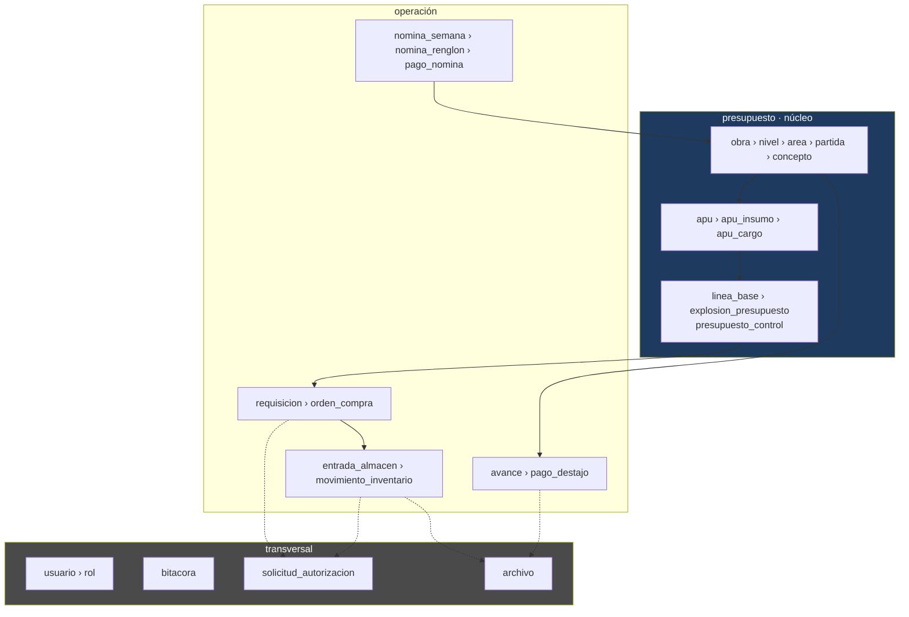

---

## 4. Presupuesto y línea base

### 4.1. Jerarquía y catálogo

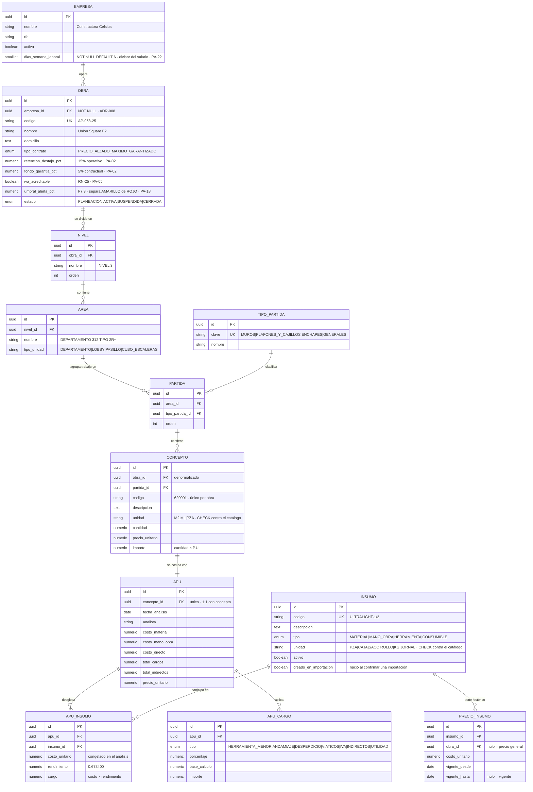

**Tres decisiones que conviene explicar.**

*El código de concepto no es global.* `620001` describe un muro estándar en las dos obras analizadas, pero **con textos y precios distintos**. Modelarlo como catálogo maestro obligaría a reconciliar descripciones que el cliente no reconcilia. El código es único **por obra**, y el cliente confirmó que hoy *"no hay un catálogo base"*. Si algún día lo hay, se añade un catálogo maestro y una referencia opcional, sin tocar lo existente.

*El insumo sí es global.* Un tablero de yeso Ultra Light es el mismo material en todas las obras; lo que cambia es su precio. Por eso el precio vive en `precio_insumo` con vigencia, no como columna del insumo. Esa tabla es la que hace posible F7.4: detectar que un insumo clave subió y recalcular el costo proyectado.

*`concepto.obra_id` está denormalizado.* Es derivable subiendo cuatro niveles, pero aparece en casi toda consulta de costo. Se mantiene coherente con una restricción que verifica que coincide con el `obra_id` alcanzable por la jerarquía.

*`empresa` existe con una sola fila y nadie filtra por ella.* Es deliberado y lo razona [ADR-008](adr/20260918-despliegue-single-tenant.md): cada despliegue atiende a una empresa, pero `obra.empresa_id` está desde el día uno porque añadir la columna después obligaría a migrar cada tabla, cada consulta y cada índice. La fila se carga con los datos semilla, antes de que exista ninguna obra: con la clave foránea obligatoria, dar de alta una obra sin empresa sembrada falla.

**Tres columnas pequeñas con un motivo cada una.** `obra.umbral_alerta_pct` es el umbral de `F7.3`, un `Porcentaje` que separa el `AMARILLO` del `ROJO` del semáforo; la alerta sale con `ROJO`. Si es nulo, toda desviación positiva es `ROJO` (`PA-18`, resuelta el 2026-10-17; el corte está en [§15](#15-la-consulta-del-semáforo)). `insumo.creado_en_importacion` marca el insumo que nació al confirmar una importación, para que el catálogo distinga lo dado de alta a mano de lo que trajo un Excel. Y `unidad`, en `concepto` y en `insumo`, lleva un `CHECK` contra el catálogo cerrado de unidades admitidas (`M2`, `ML`, `PZA`, `KG`, `CAJA`, `SACO`, `ROLLO`, `JORNAL`), el mismo que el borrador de la API declara como enum: una unidad desconocida se detiene en la importación con `UNIDAD_DESCONOCIDA` y, si alguien escribe por otra vía, en el motor (invariante 27).

### 4.2. Línea base

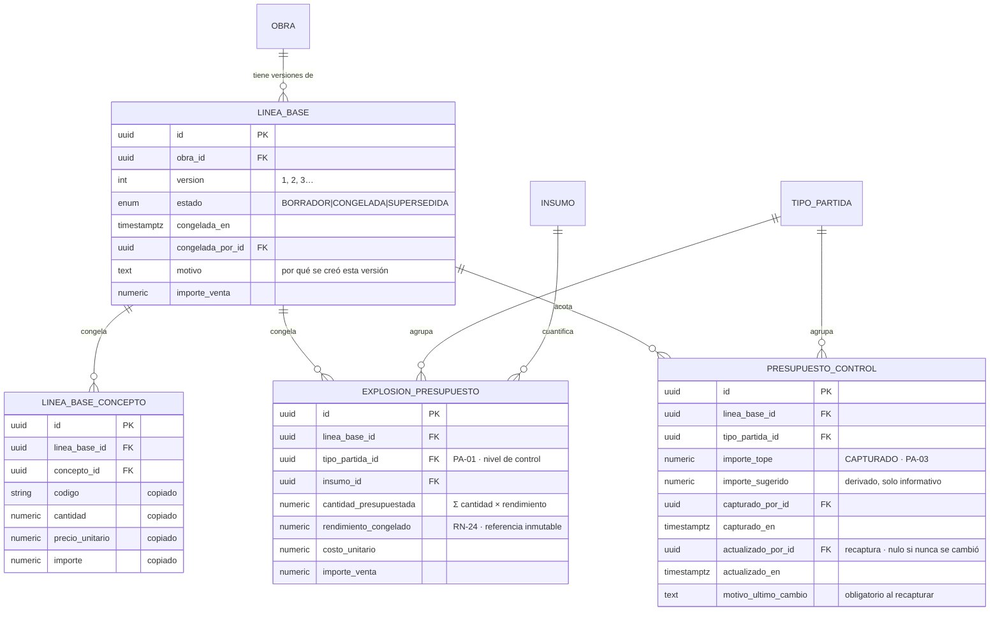

**El nivel de control es `obra + tipo de partida`** (PA-01). La jerarquía nivel › área › partida sigue existiendo para el catálogo y para medir avance, pero el gasto se controla contra **cuatro bolsas por obra**: `MUROS`, `PLAFONES Y CAJILLOS`, `ENCHAPES` y `GENERALES`. Es como el cliente razona la compra, y reduce de ~572 filas de control a 4 por obra.

**Dos tablas, porque los dos controles de `RN-03` tienen orígenes distintos:**

| Control | Tabla | Origen del dato |
|---|---|---|
| **Por importe** | `presupuesto_control.importe_tope` | **Capturado** por Dirección (PA-03). El sistema calcula un `importe_sugerido` quitando utilidad e indirectos, pero es solo una sugerencia en pantalla |
| **Por volumen** | `explosion_presupuesto.cantidad_presupuestada` | **Derivado**: `Σ cantidad_concepto × rendimiento` de todos los conceptos del tipo de partida |

Antes eran una sola tabla porque se asumía que el control se derivaba del precio de venta. Al confirmarse que se captura, separarlos es obligado: un importe capturado por una persona y una cantidad derivada de un cálculo no pueden compartir fila sin que quede ambiguo cuál es la fuente de verdad de cada uno.

`presupuesto_control` es la fila que se bloquea con `FOR UPDATE` durante la evaluación de importe ([ADR-004](adr/20260918-bloqueo-pesimista-presupuesto.md)); `explosion_presupuesto`, la de volumen.

**El tope se puede recapturar; la línea base no se puede tocar.** Son dos cosas distintas que conviene no confundir. `explosion_presupuesto` y `linea_base_concepto` son copias congeladas y el disparador del invariante 14 rechaza cualquier escritura sobre ellas. Sobre `linea_base_concepto` hay además una segunda barrera: el rol de aplicación solo tiene `SELECT` e `INSERT`. Sobre `explosion_presupuesto` no puede haberla, porque el `SELECT … FOR UPDATE` del control por volumen exige el privilegio `UPDATE` ([arquitectura §7.6](02-arquitectura.md#76-seguridad-de-la-frontera)). `presupuesto_control` **no es una copia**: se captura después de congelar y es un juicio de Dirección, no un dato del contrato. Un tope mal tecleado tiene que poder corregirse, o el error queda vivo hasta que haya una versión nueva de línea base — que es v1.1.

La corrección **no es una edición silenciosa**: exige motivo, la ejecuta únicamente Dirección General, y el valor anterior queda en `bitacora.datos_antes` con la regla `RN-03`. `actualizado_por_id` y `motivo_ultimo_cambio` dejan el último cambio visible en la propia fila sin tener que consultar la bitácora; el historial completo está en ella.

> **Subir un tope es una vía alternativa a autorizar una excepción, y hay que verlo.** Si una requisición se bloqueó contra un tope de $450,000 y Dirección sube el tope a $500,000 en lugar de resolver la solicitud, la requisición pasa sin dejar rastro en `solicitud_autorizacion`. Por eso la recaptura escribe en la bitácora **con la misma regla `RN-03`** que el bloqueo: la consulta de excepciones del escenario 11 de [HDU-003](04-historias-usuario.md#hdu-003--resolución-de-una-requisición-bloqueada) devuelve las dos cosas juntas, y un mes con muchas subidas de tope es tan visible como uno con muchas autorizaciones.

**`rendimiento_congelado` vive aquí y nunca cambia.** Es la referencia contra la que se mide la desviación. El rendimiento observado —el que aprende de la ejecución real (`RN-24`)— vive en otra tabla y no toca esta.

### 4.3. Rendimiento observado

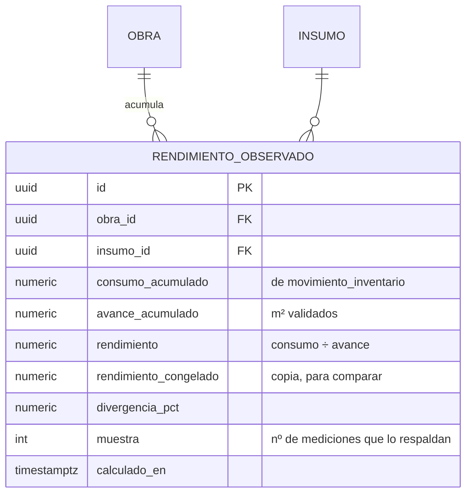

`RN-24` dice que el sistema aprende. La forma de hacerlo sin violar el principio de línea base inmutable es que **los dos rendimientos coexistan en tablas distintas**:

- El **congelado** vive en `explosion_presupuesto` y no se toca jamás. Responde a *"¿cuánto debía haberse consumido según lo presupuestado?"*
- El **observado** vive aquí, se recalcula con cada entrada de almacén y cada avance validado, y responde a *"¿cuánto se está consumiendo de verdad?"*

La desviación de costo se mide contra el congelado. La proyección del costo restante usa el observado. Sobrescribir uno con otro perdería justamente la comparación que da valor a los dos.

**Granularidad: obra e insumo.** No por tipo de partida, porque el avance físico se mide por área y etapa y el consumo por obra e insumo: cruzarlos a un nivel más fino exigiría un reparto que los datos no soportan. El cliente lo confirmó como suficiente (PA-11), con el disparador de revisión registrado en el PRD.

**`muestra` existe para no mentir con dos datos.** Un rendimiento calculado sobre 3 m² de avance no es información, es ruido. La interfaz no muestra divergencia hasta que la muestra supere un umbral configurable.

---

## 5. Compras

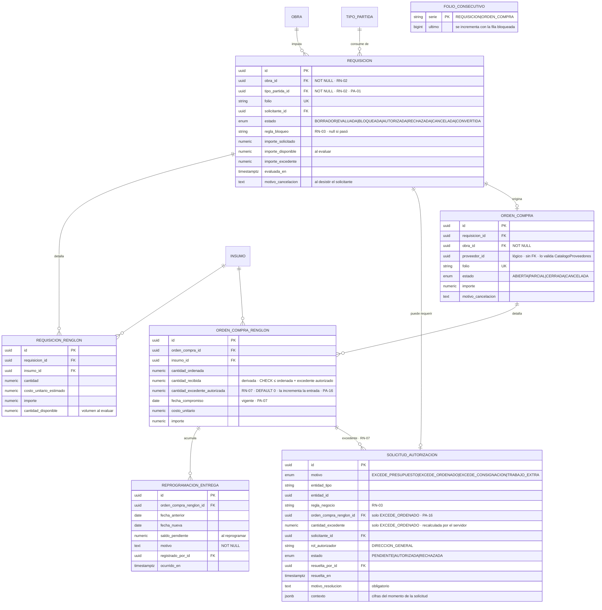

**La requisición bloqueada se guarda con las cifras del momento.** `importe_disponible` y `importe_excedente` se persisten en la propia fila. Recalcularlos después daría un número distinto —el presupuesto sigue consumiéndose— y el registro dejaría de explicar por qué se bloqueó. La solicitud de autorización guarda lo mismo en `contexto` como JSON.

**`solicitud_autorizacion` es genérica.** Sirve a RN-03 (excede presupuesto), RN-07 (excede lo ordenado), RN-15 (excede consignación) y a los trabajos extra. Un flujo de autorización por módulo multiplicaría el mismo código cuatro veces.

**El excedente de recepción autorizado se suma a la recepción** (`RN-07`, `PA-16`, resuelta el 2026-10-17). Cuando Almacén pide la autorización `EXCEDE_ORDENADO`, el servidor recalcula las cifras con la orden y el renglón —nunca toma las del cliente— y guarda en la solicitud el `orden_compra_renglon_id` y la `cantidad_excedente` solicitada. Autorizarla **no registra nada sobre la orden**: la habilita. Es la entrada que la cita la que incrementa `orden_compra_renglon.cantidad_excedente_autorizada`, de modo que una autorización que nadie usa no altera la orden. Con eso el invariante 2 pasa a `cantidad_recibida <= cantidad_ordenada + cantidad_excedente_autorizada`: el motor sigue impidiendo recibir de más, y la única vía para hacerlo pasa por una autorización resuelta.

**`motivo_resolucion` es obligatorio también al autorizar.** No solo al rechazar. Sin eso, la bitácora responde *quién autorizó* pero no *por qué*, que es la mitad de RN-04.

**No existe el cierre de una orden con saldo pendiente** (PA-07). Si el proveedor no entrega, el faltante **se reprograma**: la orden permanece en `PARCIAL`, el renglón recibe una `fecha_compromiso` nueva y `reprogramacion_entrega` guarda el rastro de cuántas veces se ha aplazado y por qué. El presupuesto sigue comprometido, porque el material sigue debiéndose.

> El historial de reprogramaciones es el dato que hoy no existe y que permite responder *"¿cuántas veces nos ha aplazado este proveedor y cuánto lleva pendiente?"*. Con un cierre manual, esa información se perdería en el momento de cerrar.

**`orden_compra.proveedor_id` no lleva clave foránea.** `proveedor` es de `proveedores`, y `proveedores` depende de `compras` ([arquitectura §5](02-arquitectura.md#5-contextos-delimitados)): una clave de la orden hacia el proveedor invertiría la arista. La existencia y la vigencia del proveedor las comprueba la emisión por el puerto `CatalogoProveedores`, que **declara `compras`** en su capa de aplicación e **implementa `proveedores`**. Es un identificador lógico, como los demás de [§2](#2-convenciones).

**Los folios no tienen huecos, y por eso no salen de una secuencia.** Una secuencia de PostgreSQL no se deshace con la transacción: una requisición que falla deja un número quemado. `folio_consecutivo` guarda el último folio de cada serie —requisición y orden de compra—, y el caso de uso lo incrementa con la fila bloqueada **dentro de la misma transacción** que crea el documento. Si la transacción se deshace, el número vuelve con ella.

**`compras` es dueño del `consumido` de `RN-03`.** `requisiciones_vivas` y `comprometido` salen de tablas suyas; el **ejercido** le llega por el puerto `FuenteEjercido`, que declara `compras` e implementan `almacen` y, en la fase 2, `avance`. La fórmula y el reparto de dueños están en [§15](#el-consumido-de-rn-03).

---

## 6. Almacén

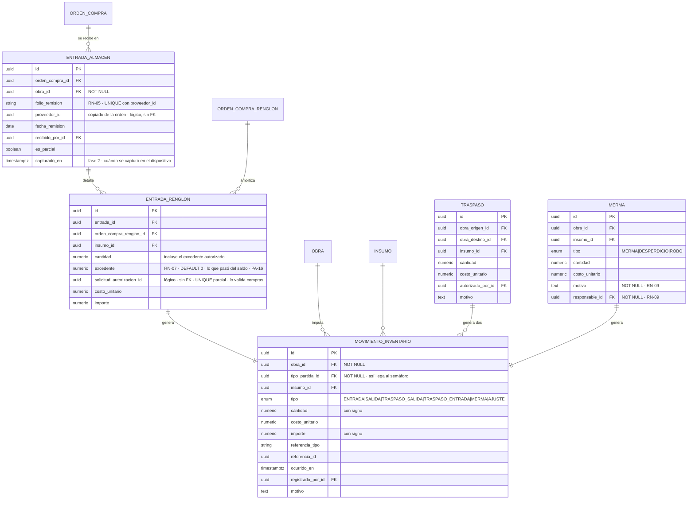

**`movimiento_inventario` es de solo-anexado.** No hay columna de existencia en ninguna parte: el stock de un insumo en una obra es `SUM(cantidad)` sobre sus movimientos. Un error se corrige con un movimiento `AJUSTE` de signo contrario y motivo, nunca borrando ni editando. Justificación en [ADR-005](adr/20260918-ledger-inventario.md). Y no se deja a la disciplina: el rol de aplicación tiene `INSERT` y `SELECT` sobre la tabla, no `UPDATE` ni `DELETE` (invariante 30).

**`entrada_almacen.proveedor_id` se copia de la orden y no lleva clave foránea**, por la misma razón que la de la orden ([§5](#5-compras)): `almacen` no depende de `proveedores`. Se copia en lugar de alcanzarse por `orden_compra_id` porque sostiene `UNIQUE (proveedor_id, folio_remision)` (invariante 29): el mismo folio de remisión del mismo proveedor no entra dos veces, aunque la comprobación del caso de uso se salte.

**`capturado_en` es de la fase 2** ([ADR-015](adr/20260919-captura-diferida-sin-conexion.md)): la hora en que el almacén capturó la entrada en el dispositivo, distinta de `creado_en`, que es cuándo llegó al servidor. La envía el cliente junto con el `id` que generó.

**`tipo_partida_id` viaja en el propio movimiento, y no es redundancia.** Un movimiento de `ENTRADA` podría alcanzar su partida subiendo por `entrada_renglon → orden_compra → requisicion`, pero **un `AJUSTE`, una `MERMA` o un `TRASPASO` no cuelgan de ninguna orden**: no tienen esa escalera. Sin la columna, la corrección de −20 bultos del escenario 8 de [HDU-005](04-historias-usuario.md#hdu-005--entrada-de-material-con-recepción-parcial) desaparecería del ejercido y la partida seguiría cargando las 70 unidades que nunca llegaron. Se copia del `tipo_partida_id` de la requisición de origen cuando lo hay, y se captura cuando no.

**Un traspaso genera dos movimientos**, `TRASPASO_SALIDA` en la obra origen y `TRASPASO_ENTRADA` en la destino, en la misma transacción. Así el costo se mueve de una obra a otra (RN-08) y ambas obras quedan cuadradas.

**El saldo pendiente de una orden es derivado**: `GREATEST(cantidad_ordenada − cantidad_recibida, 0)` por renglón. `cantidad_recibida` se mantiene denormalizada para poder declarar la restricción `CHECK (cantidad_recibida <= cantidad_ordenada + cantidad_excedente_autorizada)`, que es RN-07 aplicada por el motor y no por confianza en la aplicación. Sin excedente autorizado, `cantidad_excedente_autorizada` vale cero y la restricción es la de siempre.

**Una entrada con excedente autorizado se registra entera, y el excedente queda marcado** (`PA-16`). Almacén vuelve a enviar la entrada que se rechazó con `RN-07`, citando en el renglón `solicitud_autorizacion_id`. El caso de uso de `almacen` la valida por la interfaz publicada de `compras` —arista `almacen → compras`, la que ya existe—: tiene que estar `AUTORIZADA`, ser `EXCEDE_ORDENADO`, ser del mismo renglón y no estar consumida, y el excedente no puede pasar de su `cantidad_excedente`. Aceptada, `entrada_renglon.cantidad` es lo recibido completo, `entrada_renglon.excedente` lo que pasó del saldo, y el movimiento `ENTRADA` lleva la cantidad completa: **el excedente es costo ejercido**, porque es material que se recibió. En la misma transacción `compras` suma el excedente a `cantidad_excedente_autorizada` y la recepción a `cantidad_recibida`; con el renglón cubierto, la orden llega a `CERRADA` si ya no le queda saldo en ningún otro renglón ([§14](#orden-de-compra)).

**Una autorización se consume una sola vez, y lo dice el motor.** `entrada_renglon.solicitud_autorizacion_id` es una referencia lógica, sin clave foránea —la solicitud es de `compras`—, pero lleva un índice único parcial `WHERE solicitud_autorizacion_id IS NOT NULL`: dos entradas no pueden citar la misma autorización aunque la comprobación del caso de uso se salte (invariante 38).

*`traspaso` y `merma` son de la versión 1.1; el modelo se define ahora porque `movimiento_inventario` tiene que contemplar sus tipos desde el principio.*

---

## 7. Avance y destajo

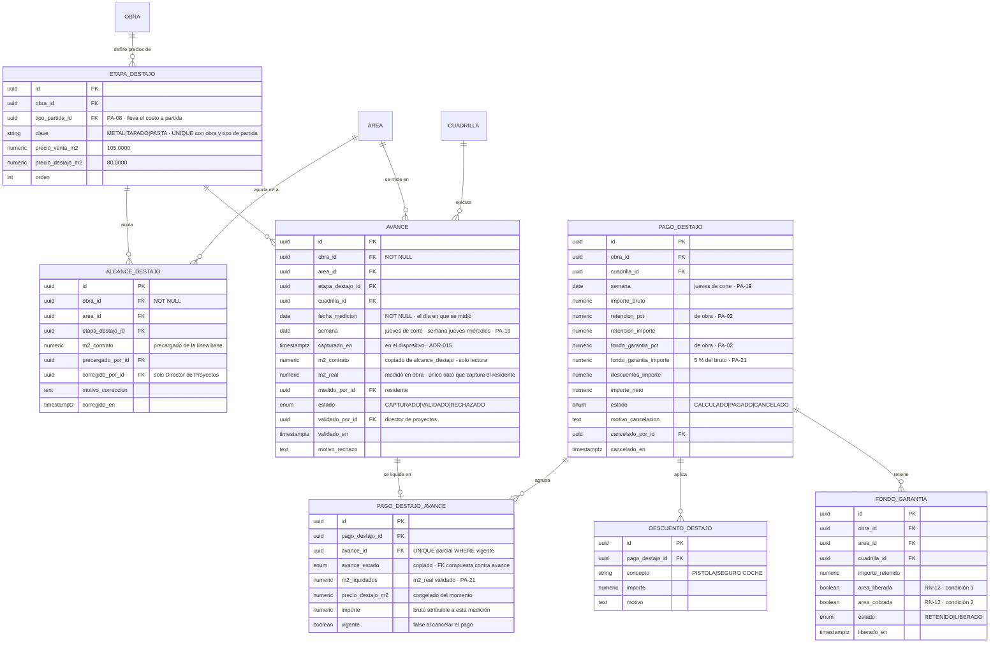

**`m2_contrato` y `m2_real` conviven en la misma fila.** Es el modelo que el cliente ya usa en su hoja de destajo, y su diferencia es la desviación de volumen que hoy se captura y nunca se agrega. Guardarlos juntos convierte esa desviación en un `SUM` (F4.7).

**Pero el residente no teclea `m2_contrato`.** Se copia de `alcance_destajo` al abrir la captura y se muestra bloqueado; el residente solo introduce `m2_real`. La razón es que la desviación de volumen —los +1.95 m² del departamento 212 que motivan F4.7— es el hallazgo que justifica medir: si quien mide escribe también el número contra el que se compara, la desviación deja de ser auditable y mide lo que el residente quiera que mida. Se copia en lugar de referenciarse para que una corrección posterior del alcance no reescriba mediciones ya validadas, igual que `nomina_renglon.salario_semanal`.

**`alcance_destajo` es el contrato de volumen por área y etapa.** Se precarga al configurar las etapas de la obra, sumando los conceptos medibles en `M2` de las partidas de ese tipo en cada área. Sirve para dos cosas y las dos importan: es el `m2_contrato` que hereda cada medición, y es el **denominador del porcentaje de avance físico** del semáforo. Solo el Director de Proyectos puede corregirlo, con motivo y bitácora: es quien valida las mediciones, así que es quien responde de la cifra contra la que se validan.

> Los conceptos que no se miden en `M2` —los que vienen en `ML` o `PZA`— no entran en el alcance. Su material sí entra en el ejercido, así que una partida con mucho trabajo no medible en m² mostrará un avance más bajo del real y una desviación inflada. El cliente lo aceptó; el disparador de revisión está en el [PRD §10](01-descripcion-producto.md#10-supuestos-y-preguntas-abiertas).

**Solo el avance en estado `VALIDADO` genera pago.** RN-10 exige que el residente mida y el Director de Proyectos valide. `pago_destajo_avance` es la tabla puente que liquida mediciones concretas en un pago, y lleva `avance_estado` copiado para poder declarar una **clave foránea compuesta** contra `avance (id, estado)`: un avance en `CAPTURADO` o `RECHAZADO` no tiene fila a la que apuntar. Es el invariante 11, y es de motor, no de disciplina. El `UNIQUE` sobre `avance_id` impide además liquidar dos veces la misma medición, y es **parcial, `WHERE vigente`** (invariante 35): cancelar un pago pone `vigente = false` en sus filas puente y libera la medición para un pago nuevo **sin borrar ninguna fila**. La fila puente lleva además su `importe` —el bruto atribuible a esa medición, `m2_liquidados × precio_destajo_m2`—, que es lo que el `ejercido` de destajo suma ([§15](#15-la-consulta-del-semáforo)): sumar `pago_destajo.importe_bruto` a través de la unión contaría el bruto del pago una vez por cada medición que liquida.

**Un pago de destajo se cancela, no se borra.** Solo desde `CALCULADO`, con `motivo_cancelacion`, `cancelado_por_id` y `cancelado_en`, que el invariante 36 exige juntos. Un pago `CANCELADO` sale del ejercido.

**Se paga sobre los m² reales validados** (`PA-21`, resuelta el 2026-10-17). `pago_destajo_avance.m2_liquidados` copia el `m2_real` de la medición validada, y su `importe` es `m2_liquidados × precio_destajo_m2`. Cada pago retiene la retención operativa (`retencion_importe`, `RN-11`) **y** el fondo de garantía (`fondo_garantia_importe`), los dos calculados sobre el bruto con los porcentajes de la obra copiados en el pago —la base del fondo es un supuesto sin bloqueo del [PRD §10](01-descripcion-producto.md#10-supuestos-y-preguntas-abiertas)—: `importe_neto = importe_bruto − retencion_importe − fondo_garantia_importe − descuentos_importe`. En el escenario 11 de [HDU-008](04-historias-usuario.md#hdu-008--avance-de-destajo-medido-y-validado), 81.87 m² × $80 dan $6,549.60 de bruto, $982.44 de retención, $327.48 de fondo y $5,239.68 de neto. Ninguna de las dos retenciones cambia el ejercido, que suma el bruto de las filas puente: lo retenido sigue siendo costo de la obra. Retener empieza en la fase 2; **liberar** el fondo, con la tabla `fondo_garantia` y sus dos banderas, sigue en la v1.1 (`RN-12`).

**La semana de una medición se deriva de su fecha.** `avance.fecha_medicion` es el día en que se midió. La semana de destajo va de **jueves a miércoles** y se identifica por su **jueves de corte**, el jueves siguiente: `semana` es el primer jueves posterior a `fecha_medicion`, así que una medición hecha en jueves abre semana y su corte es el jueves de la semana siguiente. Un `CHECK` exige que `semana` sea jueves y que `semana − fecha_medicion` esté entre 1 y 7 (invariante 37; `PA-19`, resuelta el 2026-10-17). La nómina va de viernes a jueves con el mismo jueves de corte, que es la clave por la que `RN-22` compara las dos ([§8.1](#81-la-jornada-por-qué-existe)). Un pago de destajo liquida solo mediciones de su misma semana, supuesto sin bloqueo del [PRD §10](01-descripcion-producto.md#10-supuestos-y-preguntas-abiertas). `capturado_en` es la hora en el dispositivo, distinta de `creado_en`, que es cuándo llegó al servidor ([ADR-015](adr/20260919-captura-diferida-sin-conexion.md)). `UNIQUE (area_id, etapa_destajo_id, cuadrilla_id, semana)` (invariante 31) impide que dos dispositivos que sincronizan a la vez registren dos veces la misma medición, y `UNIQUE (obra_id, tipo_partida_id, clave)` sobre `etapa_destajo` (invariante 32) que `METAL · MUROS` exista dos veces con precios distintos.

**El fondo de garantía necesita dos banderas, no una.** RN-12 exige área liberada **y** cobrada. Con un solo campo de estado, la condición doble se pierde y alguien acabará liberando garantías de un área entregada pero no cobrada.

**`etapa_destajo.tipo_partida_id` es lo que hace que el destajo llegue al tablero por partida** (PA-08). Cada etapa se define por obra **y** tipo de partida, con sus propios precios: `METAL · MUROS` y `METAL · PLAFONES Y CAJILLOS` son dos etapas distintas aunque compartan nombre. Sin esa columna, el costo de destajo se quedaría a nivel de obra igual que la nómina, y la columna de desviación por partida seguiría cubriendo solo materiales.

**Retención y fondo de garantía son dos cosas distintas** (PA-02). `pago_destajo.retencion_pct` es la retención operativa del 15 % que se aplica en cada pago semanal; `pago_destajo.fondo_garantia_pct` es el 5 % contractual, que también se retiene en cada pago (`PA-21`) y solo se libera al entregar y cobrar el área. Ambos porcentajes viven en `obra`, no en el código, y se copian en el pago para que cambiarlos no reescriba pagos ya calculados.

---

## 8. Personal y nómina

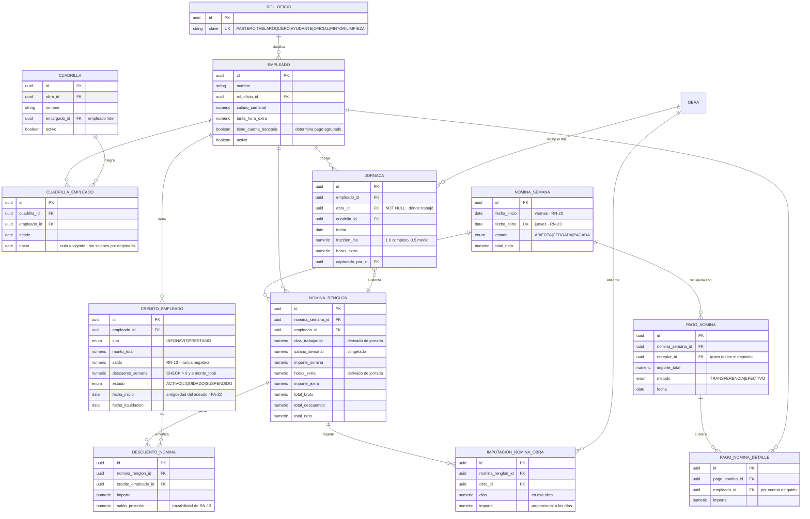

**El pago agrupado se modela separando *quién recibe* de *por quién*.** `PAGO_NOMINA.receptor_id` es el líder de cuadrilla al que se deposita; `PAGO_NOMINA_DETALLE` desglosa a qué trabajador corresponde cada peso. Es la única forma de responder a *"cuánto se le pagó a quién y por qué y para quiénes"* (RN-14) cuando el registro real dice `OMAR Y JUAN` en una sola línea.

Una restricción cierra el modelo: **la suma del detalle tiene que igualar el importe del pago**. Sin ella, el desglose se desincroniza del depósito y la trazabilidad se vuelve decorativa.

**`saldo_posterior` en cada descuento** deja el rastro completo de la amortización de un crédito: qué semana, cuánto se descontó y cómo quedó. RN-13 exige marcar el crédito como liquidado al llegar a cero, y esta columna permite auditar que la transición ocurrió cuando debía.

**`salario_semanal` se copia en el renglón.** Si el salario del empleado cambia, las nóminas anteriores no pueden cambiar con él.

**Una persona está en una sola cuadrilla a la vez, y lo dice el motor.** `cuadrilla_empleado` lleva una restricción de exclusión con `btree_gist` que impide dos asignaciones del mismo empleado con rangos `[desde, hasta]` solapados (invariante 33). De esa tabla depende a qué cuadrilla se imputa cada jornada y, por tanto, qué modalidad reclama (`RN-22`): con dos asignaciones simultáneas la exclusividad dejaría de tener un sujeto único. `cuadrilla.activo` es la baja lógica de la cuadrilla, como en todo catálogo.

**Un crédito no se puede dar de alta imposible de amortizar.** `CHECK (descuento_semanal > 0 AND descuento_semanal <= monto_total)` (invariante 34): un descuento cero dejaría el crédito vivo para siempre, y uno mayor que el total lo liquidaría con saldo negativo, que el invariante 3 ya prohíbe pero demasiado tarde.

**Tres reglas de cálculo que el cliente fijó** (`PA-22`, resuelta el 2026-10-17), y ninguna es una constante del código:

- **La semana laboral tiene 6 días**, guardados en `empresa.dias_semana_laboral SMALLINT NOT NULL DEFAULT 6`. Es el divisor del salario semanal —`importe_nomina = salario_semanal ÷ dias_semana_laboral × dias_trabajados`— y el máximo de días de un renglón: `dias_trabajados` no puede pasar de él. Es un parámetro de la empresa, no de la obra, porque la semana de nómina es de la empresa.
- **Si el bruto no alcanza, los descuentos se aplican por antigüedad del adeudo**: primero lo que se debe desde más semanas atrás, sin prioridad por tipo de crédito —Infonavit y préstamo compiten igual—. La antigüedad se mide por `credito_empleado.fecha_inicio`, la semana en que el crédito empezó a descontarse: el más antiguo se descuenta primero, y a igual fecha, el de menor saldo *(asumido, sin bloqueo: el cliente dijo "conforme vayan debiéndose de las semanas" y no cómo desempatar)*. El orden lo decide el dominio; `descuento_nomina.saldo_posterior` deja el rastro para auditarlo.
- **La semana pasa a `PAGADA` por el rol `ADMINISTRACION`.** Qué hacer con el saldo de un crédito al dar de baja al empleado no es una regla del modelo: es la decisión explícita que HDU-007 pide al dar de baja.

**La cuadrilla que cobra por destajo también registra jornada.** `RN-23` exige saber cuándo y dónde trabajó cada empleado, así que sus integrantes tienen `jornada` como todos; lo que no generan es renglón de nómina en la semana en que su cuadrilla cobró por destajo (supuesto sin bloqueo del [PRD §10](01-descripcion-producto.md#10-supuestos-y-preguntas-abiertas)). Si una cuadrilla choca con `RN-22`, el rechazo es **solo de esa cuadrilla**: la nómina de los demás se calcula (`PA-20`, resuelta el 2026-10-17).

### 8.1. La jornada: por qué existe

`RN-23` cambió el modelo. El cliente lo dijo así: *"se paga lo trabajado del día viernes al jueves aunque se trabaje en obras distintas; se tiene que tener cuándo y dónde trabajó el empleado."*

Tres consecuencias, y ninguna es cosmética:

**La semana no es natural.** Va de **viernes a jueves**, con corte el jueves y pago el sábado — el mismo día de corte que los proveedores (`RN-17`). `nomina_semana` guarda `fecha_inicio` y `fecha_corte` explícitas en lugar de un número de semana, porque ningún estándar de semana ISO coincide con este calendario.

**El destajo tiene otra semana, con el mismo corte.** La semana de destajo va de **jueves a miércoles** (`PA-19`, resuelta el 2026-10-17); la de nómina, de viernes a jueves. Las dos se identifican por su **jueves de corte**: la de destajo del jueves 20 al miércoles 26 y la de nómina del viernes 21 al jueves 27 comparten el corte del jueves 27. Por eso `modalidad_pago_semana.semana`, `pago_destajo.semana` y `nomina_semana.fecha_corte` son la misma clave, y `RN-22` compara por ella (invariantes 15, 18 y 37).

**`nomina_semana` dejó de colgar de una obra.** Antes tenía `obra_id`, lo que presuponía que un empleado trabajaba en una sola obra por semana. Es falso. Ahora la semana de nómina es de la empresa; la obra entra por la jornada.

**El costo por obra se deriva, no se estima.** Cada día trabajado se registra con su obra. `imputacion_nomina_obra` reparte el neto del empleado en proporción a los días efectivamente trabajados en cada obra: tres días en Union Square y dos en ENITI reparten 3/5 y 2/5. Es lo que lee el semáforo.

> El supuesto anterior —*"imputación por cuadrilla-semana-obra, con reparto manual si hay varias"*— habría producido un costo de mano de obra por obra que era una estimación presentada como dato. En un producto cuyo propósito es que la dirección confíe en la cifra, esa diferencia lo es todo.

`UNIQUE (empleado_id, fecha)` impide que un empleado tenga dos jornadas el mismo día, que es la única forma de que el reparto sumara más del 100 %.

---

## 9. Proveedores · v1.1

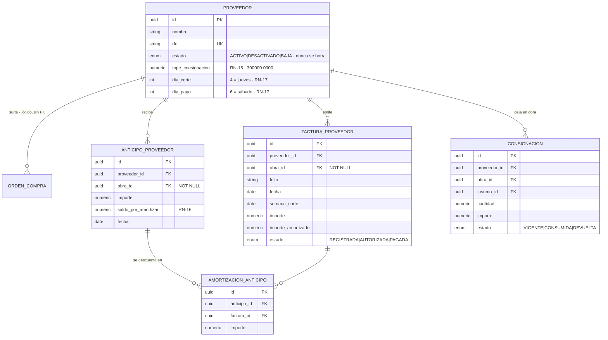

**El tope de consignación vive en el proveedor, no en una constante.** El cliente dio un ejemplo (`CoPanel · $300,000`) pero es evidentemente configurable por proveedor.

**`orden_compra.proveedor_id` existe desde el MVP** aunque el módulo completo sea v1.1: la orden de compra necesita saber a quién se le pide desde el primer día. En MVP el proveedor es un catálogo mínimo (nombre y RFC); las funcionalidades de anticipos y consignación llegan después. La columna de la orden **no lleva clave foránea** ([§5](#5-compras)): la valida el puerto `CatalogoProveedores`, que `proveedores` implementa respondiendo si el proveedor existe y si está `ACTIVO`.

**`UNIQUE (rfc)`** (invariante 28) detiene en el motor el proveedor duplicado de [HDU-004](04-historias-usuario.md#hdu-004--proveedores-y-emisión-de-órdenes-de-compra). **`estado` distingue dos salidas que no son la misma.** `DESACTIVADO` se admite siempre: el proveedor deja de ofrecerse en el selector y en la emisión, y sus órdenes vivas siguen recibiendo material. `BAJA` es la baja lógica definitiva y se rechaza con `409` `CONFLICTO` `PROVEEDOR_CON_ORDENES_ABIERTAS` mientras tenga órdenes `ABIERTA` o `PARCIAL`, ofreciendo desactivar. Ninguna de las dos borra la fila ni su historial.

---

## 10. Identidad y auditoría

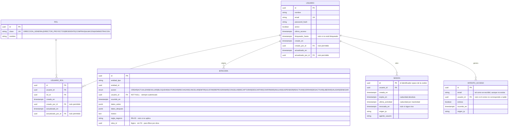

`usuario.email` se guarda en minúsculas: lo normaliza el código y lo exige `ck_usuario_email_minusculas` (TKT-006).

La relación `usuario_rol` es de muchos a muchos porque el PRD asume que en una empresa de este tamaño una persona puede acumular roles. Una persona no tiene dos veces el mismo rol: `usuario_rol` lleva `UNIQUE (usuario_id, rol_id)`.

**`bitacora.regla_negocio`** es la columna que convierte la bitácora en algo consultable. Permite responder *"¿cuántas veces se intentó sobregirar una partida este mes y quién lo autorizó?"* con una consulta, que es exactamente el tipo de pregunta que hoy no tiene respuesta.

La tabla se protege a nivel de motor: el rol de aplicación tiene permiso de `INSERT` y `SELECT`, no de `UPDATE` ni `DELETE`.

`ocurrido_en` lo fija el caso de uso con su reloj, sin `DEFAULT`; el `id` lo genera la aplicación. La bajada de la migración se niega si la tabla tiene asientos.

**`bitacora.obra_id` es un identificador lógico, sin clave foránea.** `auditoria` es transversal y no depende de nadie ([arquitectura §5](02-arquitectura.md#5-contextos-delimitados)); una clave hacia `obra` la haría depender de `presupuesto`. La obra la copia el caso de uso que asienta, igual que `entidad_tipo` + `entidad_id`.

**El enum `accion` es cerrado y es el mismo que el borrador de la API declara en `AccionBitacora`.** Veintidós verbos: `CREAR`, `ACTUALIZAR`, `EVALUAR`, `BLOQUEAR`, `AUTORIZAR`, `RECHAZAR`, `CANCELAR`, `EMITIR`, `AJUSTAR`, `REPROGRAMAR`, `CONGELAR`, `RECAPTURAR`, `DESCARTAR`, `CONFIRMAR`, `ANULAR`, `SUSPENDER`, `REACTIVAR`, `CERRAR`, `DESACTIVAR`, `LIBERAR`, `VALIDAR` y `DENEGAR`. Un verbo nuevo es una migración del enum y un cambio del borrador en el mismo PR.

**Un `403` se asienta como `DENEGAR`, en una transacción propia.** Es la única escritura en la bitácora que no acompaña a un cambio —no hay cambio que acompañar—, así que no puede ir "en la misma transacción". Siempre lleva usuario autenticado: `usuario_id` sigue siendo `NOT NULL`. Las denegaciones **anónimas** —una prueba de origen CSRF ausente, unas credenciales erróneas al iniciar sesión— no tienen a quién atribuirse y no van a la bitácora: van a `intento_acceso` y al registro técnico. Un `403` sin recurso se atribuye a quien se le denegó: `entidad_tipo = 'usuario'` y `entidad_id = usuario_id`. Ni el identificador de la sesión —es la credencial de la cookie, y el rol de lectura lee la bitácora— ni la correlación de la petición —va al registro técnico ([API §2.7](07-especificacion-api.md#27-correlación))— entran en el asiento (TKT-007).

### `sesion` — por qué es una tabla y no una firma

**La cookie no lleva información, lleva un identificador.** Todo lo que decide qué puede hacer alguien —si sigue activo, qué roles tiene, si la sesión sigue viva— se resuelve contra la base de datos en cada petición.

La alternativa es una credencial autocontenida y firmada, sea un JWT o una cookie de sesión firmada. Las dos funcionan y las dos tienen el mismo defecto aquí: **quitarle el rol a alguien no surte efecto hasta que su credencial caduca**. En un sistema donde el rol decide quién puede autorizar un sobregiro, esa ventana convierte un control en un trámite. Razonado en [ADR-014](adr/20260919-sesion-con-estado.md).

Consecuencia operativa: una sesión se cierra escribiendo `revocada_en`, **nunca borrando la fila**. Quién estuvo conectado y desde dónde es un dato de auditoría, no basura que limpiar. Las filas caducadas se purgan por antigüedad, no al cerrar sesión.

### `intento_acceso` — el bloqueo necesita memoria

`RNF-04` exige limitar los intentos, y para limitarlos hay que contarlos. La tabla guarda todos los intentos, **también los que fallan por un correo que no existe**: son la forma habitual de sondear qué cuentas hay.

**`usuario.bloqueado_hasta` es la decisión; `intento_acceso` es la evidencia.** Separarlas permite que el bloqueo se compruebe con una lectura de la fila del usuario, sin contar nada, y que el recuento viva en una tabla que crece y se purga sin tocar el catálogo de usuarios.

> **El bloqueo es temporal y nunca permanente.** Una cuenta bloqueada para siempre por intentos fallidos es una denegación de servicio que cualquiera puede provocar contra el Director de Proyectos un viernes por la tarde.

---

## 11. Importación

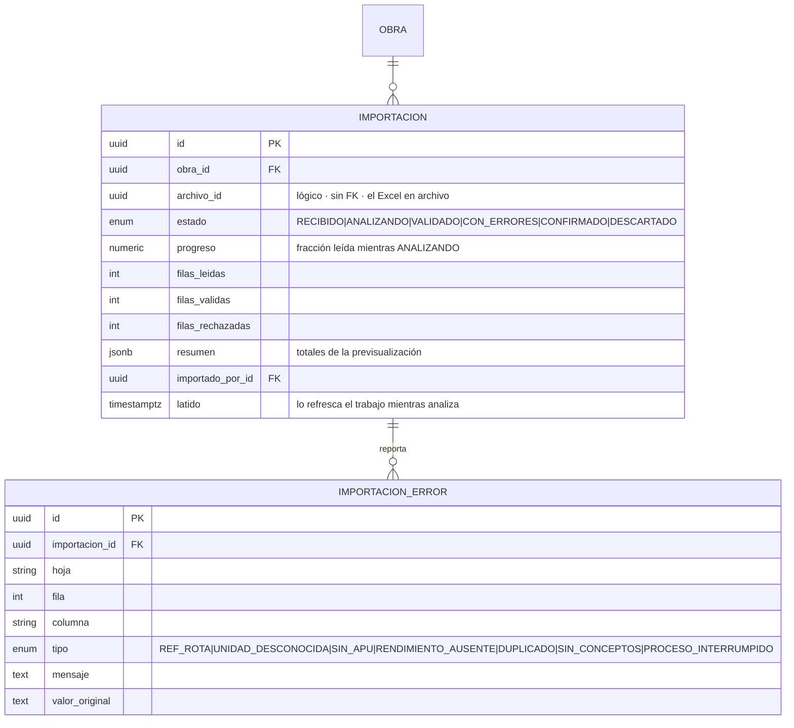

**El Excel ya no cuelga de esta tabla con dos cadenas sueltas.** `archivo_nombre` y `archivo_url` eran el hueco que `C8` cierra: no decían quién subió el archivo, ni cuánto pesaba, ni si seguía siendo el mismo. El adjunto vive ahora en [`archivo`](#12-archivos-adjuntos) con `referencia_tipo = 'IMPORTACION'`, y la importación no empieza a analizar hasta que ese adjunto está `DISPONIBLE`. `importacion.archivo_id` lo señala en sentido contrario, como identificador lógico **sin clave foránea**: en el esquema `presupuesto` no depende de `archivos`; en el código lo usa solo por su interfaz publicada, que valida la referencia al crear la importación.

**`progreso` es un `Porcentaje` que el trabajo actualiza mientras analiza**, junto con el `latido`; nulo fuera de `ANALIZANDO`. Es lo que pinta la barra de la pantalla de carga sin que el cliente adivine.

**`SIN_CONCEPTOS` es el error de un archivo que abre pero no trae nada.** Una hoja con formato válido y sin ninguna fila de concepto no es un error de forma —el archivo pasó la comprobación estructural—, así que no se rechaza con `422` al crear: la importación queda `CON_ERRORES` con un error de este tipo, igual que la que trae filas rotas.

El tipo `REF_ROTA` no es hipotético: el catálogo de Union Square tiene `#REF!` en todas sus columnas de precio. El importador tiene que reportarlo fila por fila, no fallar en bloque.

**`latido` y `PROCESO_INTERRUMPIDO` existen para un fallo que no es del archivo, sino del servidor** (`RNF-17`). El análisis corre dentro del proceso del API; si ese proceso se reinicia a mitad, la fila se queda en `ANALIZANDO` y no hay nadie que la mueva — y mientras tanto la obra no admite otra importación. Al arrancar, la aplicación barre las importaciones en `ANALIZANDO` con el latido vencido, las pasa a `CON_ERRORES` y les añade un error de este tipo.

Es el mínimo que hace falta: la fase de análisis no escribe en el modelo real, así que una interrupción no puede dejar datos a medias. Solo puede dejar una fila mintiendo sobre su propio estado, y eso sí necesita quien lo corrija.

---

## 12. Archivos adjuntos

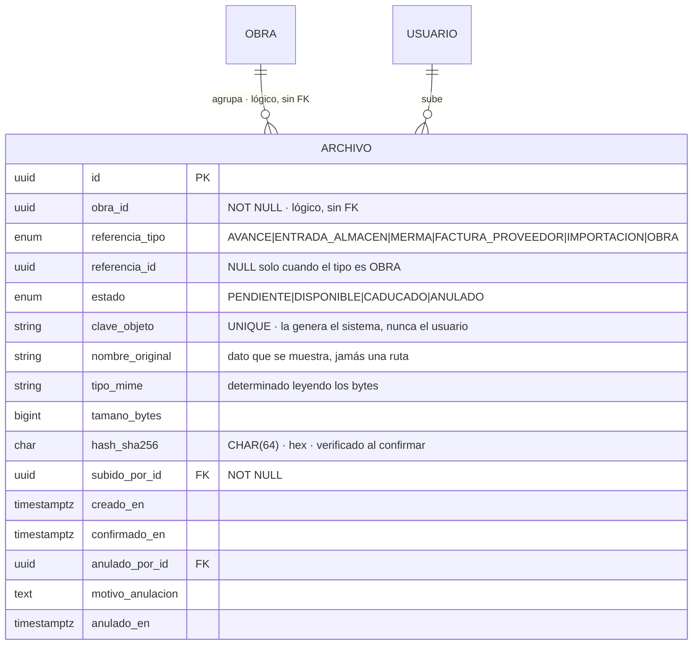

**Una sola tabla para los seis tipos de adjunto de `C8`, y la referencia es polimórfica.** `referencia_tipo` + `referencia_id` dicen a qué documento pertenece. No hay clave foránea, y no la hay por la misma razón que `archivos` es un módulo transversal: una clave de `archivo` hacia `avance`, `entrada_almacen` y `factura_proveedor` convertiría a `archivos` en el módulo del que dependen todos, y el grafo de la [arquitectura §5](02-arquitectura.md#5-contextos-delimitados) dejaría de ser acíclico.

Es el mismo recurso que `movimiento_inventario` ya usa para los movimientos que no cuelgan de una orden, **con una diferencia deliberada**: allí `referencia_tipo` es texto libre, aquí es `ENUM`. El conjunto de cosas a las que se puede adjuntar es cerrado y lo decide el diseño, no el usuario; y el invariante 26 necesita comparar contra un valor que el motor conozca.

El precio está declarado en la [arquitectura §7.7](02-arquitectura.md#77-archivos-y-evidencia): **la integridad referencial del adjunto no la da el motor**. Es una de las pocas referencias lógicas del esquema, todas enumeradas en [§2](#2-convenciones), y la única polimórfica junto a la de `movimiento_inventario`. La alternativa —una tabla de adjuntos por cada módulo— daría claves foráneas reales a cambio de repetir cinco veces la subida, la validación de tipo, la confirmación por hash y el barrido de caducados.

**`obra_id` sí es `NOT NULL`, y es lo que hace útil el expediente.** Es un identificador **lógico, sin clave foránea**, por la misma razón que `referencia_id`: `archivos` no depende de `presupuesto`, y una clave hacia `obra` le daría esa arista. Lo copia el caso de uso que da de alta el adjunto, del documento al que pertenece. Todo archivo pertenece a una obra, incluidos los documentos generales de `F8.4`, que son los únicos con `referencia_id` nulo. Se puede exigir porque **las cinco tablas adjuntables ya lo tienen `NOT NULL`** —`avance`, `entrada_almacen`, `merma`, `factura_proveedor` e `importacion`—, así que copiarlo nunca falla. Sin esa columna, `F8.5` —consultar el expediente de una obra— tendría que recorrer esas cinco tablas para saber qué archivos le pertenecen.

### Dos índices, y los dos hacen falta

| Índice | Para qué |
|---|---|
| `(obra_id, estado, creado_en DESC)` | El expediente de `F8.5`: los adjuntos `DISPONIBLE` de una obra, los últimos primero. Es la consulta de la pantalla |
| `(referencia_tipo, referencia_id)` | La contraria y la más frecuente: los adjuntos **de este avance**, **de esta entrada**. Se ejecuta cada vez que se abre un documento |

Un tercero, parcial, para el barrido: `(creado_en) WHERE estado = 'PENDIENTE'`. Sin él, la tarea de arranque recorre la tabla entera para encontrar un puñado de filas, y la tabla crece con cada foto de cada medición de cada obra.

### El estado, y por qué hay cuatro

| Estado | Qué significa | Quién lo pone |
|---|---|---|
| `PENDIENTE` | La fila existe, el objeto puede que no | El caso de uso que emite la URL prefirmada, sea el que crea el documento o uno posterior que adjunta sobre él |
| `DISPONIBLE` | El objeto existe y su tamaño y su hash coinciden con lo que se declaró | La confirmación, tras verificar contra el almacén |
| `CADUCADO` | La subida nunca se confirmó a tiempo: la fila queda como rastro y el objeto, si llegó, se elimina | El barrido de arranque. **No necesita autor**, y por eso no es `ANULADO` |
| `ANULADO` | El adjunto ya no cuenta, pero su rastro permanece con autor y motivo | Quien lo anula, nunca un `DELETE` |

**La escritura no es transaccional y el estado es lo que lo hace visible.** El objeto vive fuera de PostgreSQL, así que no hay forma de que la fila y los bytes se escriban juntos ([ADR-016](adr/20261001-almacenamiento-de-objetos.md)). Un `PENDIENTE` cuya subida nunca llegó se barre al arrancar la aplicación y pasa a `CADUCADO`, exactamente igual que una importación con el latido vencido (`RNF-17`): es el mismo problema —un trabajo en dos pasos cuyo segundo paso puede no ocurrir— y se resuelve con el mismo patrón en vez de con uno nuevo.

**El adjunto puede nacer después que el documento, y tiene que poder.** La octava regla de ADR-016 obliga: el avance capturado en obra se sincroniza sin esperar a sus fotos, y estas se adjuntan contra una medición que ya existe. Por eso el caso de uso que crea la fila `PENDIENTE` no es siempre el que crea el documento, y **lo único que se exige es que el documento exista** — un adjunto no puede referenciar lo que todavía no se ha guardado.

**Un archivo no se borra nunca.** Es el principio del libro mayor ([ADR-005](adr/20260918-ledger-inventario.md)) aplicado a la evidencia: en un sistema cuyo valor es la trazabilidad, poder borrar la foto de una merma o la remisión de una entrada discutida es poder borrar justo lo que alguien querría que desapareciera.

### El hash no es higiene, es la prueba

`hash_sha256` se verifica al confirmar y **se asienta en la bitácora junto al adjunto**. Es lo que separa *"la bitácora dice que se adjuntó el archivo 7f3a…"* de *"la bitácora dice que se adjuntó un archivo cuyo contenido era exactamente este"*. La primera afirmación no se puede comprobar dentro de dos años; la segunda sí, y `RNF-19` exige la segunda.

Sirve además para dos cosas que salen gratis: detectar un objeto corrompido en una restauración, y reconocer el mismo archivo subido dos veces.

### Qué cambia respecto del modelo anterior

Dos columnas desaparecen y las sustituye esta tabla:

| Antes | Ahora |
|---|---|
| `merma.evidencia_url` | `archivo` con `referencia_tipo = 'MERMA'`. La evidencia de `RN-09` deja de ser una cadena suelta y pasa a tener tipo verificado, tamaño, autor, hash y estado |
| `importacion.archivo_url` | `archivo` con `referencia_tipo = 'IMPORTACION'`, señalado desde `importacion.archivo_id`. El Excel importado entra por la misma puerta que todo lo demás |

Ninguna de las dos guardaba quién subió el archivo, ni cuánto pesaba, ni qué era. Eran el hueco que la capacidad `C8` cierra.

---

## 13. Invariantes en base de datos

Estos invariantes se declaran en el esquema porque **un invariante que solo vive en el código se rompe el día que alguien escribe por otra vía** — un script de migración, una corrección manual, un endpoint nuevo que olvidó la validación.

| # | Invariante | Mecanismo | Regla |
|---|---|---|---|
| 1 | Todo movimiento de costo tiene obra, y requisición y movimiento de inventario además tipo de partida | `NOT NULL` en `obra_id` de requisición, orden, entrada, movimiento, jornada, avance · `NOT NULL` en `requisicion.tipo_partida_id` y `movimiento_inventario.tipo_partida_id` | RN-02 |
| 2 | No se recibe más de lo ordenado sin un excedente autorizado | `CHECK (cantidad_recibida <= cantidad_ordenada + cantidad_excedente_autorizada)` y `CHECK (cantidad_excedente_autorizada >= 0)` sobre `orden_compra_renglon` · `CHECK (excedente >= 0)` sobre `entrada_renglon` | RN-07 |
| 3 | El saldo de un crédito nunca es negativo | `CHECK (saldo >= 0)` | RN-13 |
| 4 | Un crédito liquidado tiene saldo cero | `CHECK (estado <> 'LIQUIDADO' OR saldo = 0)` | RN-13 |
| 5 | Una sola línea base congelada vigente por obra | Índice único parcial `WHERE estado = 'CONGELADA'` | RN-01 |
| 6 | Un presupuesto de control por línea base y tipo de partida | `UNIQUE (linea_base_id, tipo_partida_id)` | RN-03 |
| 7 | El desglose de un pago agrupado suma el total | Restricción diferida verificada al confirmar | RN-14 |
| 8 | Cantidades y precios no negativos | `CHECK (cantidad >= 0)`, `CHECK (costo_unitario >= 0)` | — |
| 9 | Una resolución de autorización exige motivo | `CHECK (estado = 'PENDIENTE' OR motivo_resolucion IS NOT NULL)` | RN-04 |
| 10 | La bitácora no se modifica | Permisos: sin `UPDATE` ni `DELETE` para el rol de aplicación | RN-04 |
| 11 | Un avance pagado está validado | Clave foránea compuesta que incluye el estado | RN-10 |
| 12 | El fondo se libera solo con las dos condiciones | `CHECK (estado <> 'LIBERADO' OR (area_liberada AND area_cobrada))` | RN-12 |
| 13 | Un concepto es único por obra | `UNIQUE (obra_id, codigo)` | — |
| 14 | Una línea base congelada no se altera | Disparador que rechaza `UPDATE`/`DELETE` sobre sus copias · sobre `linea_base_concepto`, además, el rol de aplicación solo tiene `SELECT` e `INSERT` | RN-01 |
| 15 | Una cuadrilla cobra por destajo **o** por nómina en una semana, nunca por ambas | `UNIQUE (cuadrilla_id, semana)` sobre `modalidad_pago_semana` · `semana` con `CHECK` de jueves: el jueves de corte, común a destajo y nómina (`PA-19`) | RN-22 |
| 16 | Un empleado no tiene dos jornadas el mismo día | `UNIQUE (empleado_id, fecha)` sobre `jornada` | RN-23 |
| 17 | El reparto de nómina entre obras suma el neto del renglón | Restricción diferida sobre `imputacion_nomina_obra` | RN-23 |
| 18 | Una semana de nómina va de viernes a jueves | `CHECK (fecha_corte = fecha_inicio + 6 AND EXTRACT(DOW FROM fecha_corte) = 4)` | RN-23 |
| 19 | El rendimiento congelado nunca se sobrescribe con el observado | Viven en tablas distintas: `explosion_presupuesto` y `rendimiento_observado` | RN-24 |
| 20 | El registro de intentos de acceso no se altera desde la aplicación | Permisos: el rol de aplicación tiene `INSERT` y `SELECT` sobre `intento_acceso`, no `UPDATE` ni `DELETE` | `RNF-04` |
| 21 | Las consultas de analítica no pueden escribir | Rol de PostgreSQL con solo `SELECT`, que es con el que `analitica` se conecta; sin acceso a `sesion` ni a `usuario.password_hash` | `RNF-09` |
| 22 | El alcance de destajo es único por área y etapa: precargarlo dos veces duplicaría el denominador del avance | `UNIQUE (area_id, etapa_destajo_id)` sobre `alcance_destajo` | RN-21 |
| 23 | Un archivo disponible tiene hash, tamaño y fecha de confirmación | `CHECK (estado <> 'DISPONIBLE' OR (hash_sha256 IS NOT NULL AND tamano_bytes IS NOT NULL AND confirmado_en IS NOT NULL))` | `RNF-19` |
| 24 | Anular un adjunto exige autor y motivo | `CHECK (estado <> 'ANULADO' OR (anulado_por_id IS NOT NULL AND motivo_anulacion IS NOT NULL))` | `RNF-19` |
| 25 | Dos filas no comparten objeto | `UNIQUE (clave_objeto)` sobre `archivo` | `RNF-19` |
| 26 | Todo adjunto señala a un documento, salvo los del expediente general de la obra | `CHECK (referencia_tipo = 'OBRA' OR referencia_id IS NOT NULL)` | — |
| 27 | La unidad de un concepto o de un insumo pertenece al catálogo admitido | `CHECK (unidad IN ('M2','ML','PZA','KG','CAJA','SACO','ROLLO','JORNAL'))` sobre `concepto` e `insumo` | — |
| 28 | Un proveedor no se da de alta dos veces | `UNIQUE (rfc)` sobre `proveedor` | — |
| 29 | Una remisión de un proveedor no entra dos veces | `UNIQUE (proveedor_id, folio_remision)` sobre `entrada_almacen` | RN-05 |
| 30 | El libro mayor de inventario es de solo-anexado | Permisos: el rol de aplicación tiene `INSERT` y `SELECT` sobre `movimiento_inventario`, no `UPDATE` ni `DELETE` | — |
| 31 | Una medición es única por área, etapa, cuadrilla y semana · *fase 2* | `UNIQUE (area_id, etapa_destajo_id, cuadrilla_id, semana)` sobre `avance` | RN-10 |
| 32 | Una etapa de destajo es única por obra, tipo de partida y clave · *fase 2* | `UNIQUE (obra_id, tipo_partida_id, clave)` sobre `etapa_destajo` | — |
| 33 | Un empleado no está en dos cuadrillas a la vez · *fase 2* | Restricción de exclusión con `btree_gist` sobre `cuadrilla_empleado (empleado_id, daterange(desde, hasta, '[]'))` · `CHECK (hasta IS NULL OR hasta >= desde)` | RN-22 |
| 34 | Un crédito tiene un descuento semanal amortizable · *fase 2* | `CHECK (descuento_semanal > 0 AND descuento_semanal <= monto_total)` sobre `credito_empleado` | RN-13 |
| 35 | Una medición se liquida en un solo pago vigente · *fase 2* | Índice único parcial `(avance_id) WHERE vigente` sobre `pago_destajo_avance` | RN-10 |
| 36 | Cancelar un pago de destajo exige autor, motivo y fecha · *fase 2* | `CHECK (estado <> 'CANCELADO' OR (motivo_cancelacion IS NOT NULL AND cancelado_por_id IS NOT NULL AND cancelado_en IS NOT NULL))` sobre `pago_destajo` | — |
| 37 | La semana de destajo va de jueves a miércoles y se identifica por su jueves de corte · *fase 2* | `CHECK (EXTRACT(DOW FROM semana) = 4)` sobre `avance`, `pago_destajo` y `modalidad_pago_semana` · en `avance`, además, `CHECK (semana - fecha_medicion BETWEEN 1 AND 7)` (`PA-19`) | RN-23 |
| 38 | Una autorización de excedente se consume una sola vez | Índice único parcial `(solicitud_autorizacion_id) WHERE solicitud_autorizacion_id IS NOT NULL` sobre `entrada_renglon` | RN-07 |

**El invariante 21 tiene una consecuencia para `usuario` (`PA-T4` de TKT-003, en `sdd/tickets/tkt-003/spec.md`).** El rol de lectura recibe `GRANT SELECT` por columna sobre `usuario`: las diez columnas que no son `password_hash`. Por eso toda columna nueva de `usuario` necesita su propio `GRANT` al rol de lectura si `analitica` la necesita, y un `SELECT *` sobre `usuario` falla con ese rol. Falla hacia el lado seguro: una columna olvidada no se filtra, simplemente no se lee. Y la regla vale para las tablas futuras: toda tabla que guarde credenciales o secretos revoca `SELECT` al rol de lectura en su propia migración, con su prueba.

**El invariante 15 se apoya en una tabla que existe solo para sostenerlo.** `modalidad_pago_semana` guarda una fila por cuadrilla y semana con la modalidad reclamada (`DESTAJO` o `NOMINA`). La unicidad es **por cuadrilla y semana, sin la obra**: `RN-22` habla de cuadrilla y semana, no de obra, y la clave dice exactamente lo que dice la regla; `obra_id` se conserva para filtrar, fuera de la unicidad. El primer pago de la semana la inserta; el segundo, si es de la otra modalidad, choca contra la restricción única y falla. Sin ella la regla dependería de una comprobación en la aplicación que cualquier ruta nueva podría saltarse, y la consecuencia —contabilizar dos veces el mismo trabajo en el semáforo— es silenciosa.

```
modalidad_pago_semana
  id UUID PK · obra_id FK · cuadrilla_id FK · semana DATE
  modalidad ENUM('DESTAJO','NOMINA')
  UNIQUE (cuadrilla_id, semana)
  CHECK (EXTRACT(DOW FROM semana) = 4)      -- jueves de corte · PA-19
```

El invariante 14 merece una nota: es el único que necesita un disparador en lugar de una restricción declarativa, porque PostgreSQL no permite marcar filas como inmutables de forma nativa. Dado que el principio 1 es el más importante del producto, el disparador está justificado.

**Los invariantes 23 a 26 protegen el adjunto, y hay uno que deliberadamente no está.** Ninguno garantiza que `referencia_id` apunte a una fila que exista: la referencia es polimórfica y el motor no puede comprobarla ([§12](#12-archivos-adjuntos)). Junto con las demás referencias lógicas de [§2](#2-convenciones) —que existen para no invertir una arista del grafo de módulos—, es integridad referencial que se deja en manos del caso de uso; está declarada como coste en [ADR-016](adr/20261001-almacenamiento-de-objetos.md), y se compensa con lo que sí se puede declarar: que un archivo `DISPONIBLE` tenga hash verificado, que anularlo exija motivo y que ningún objeto se reutilice.

**Las referencias lógicas son una lista cerrada, no una costumbre.** Además de la pareja `referencia_tipo` + `referencia_id` de `archivo` y de `movimiento_inventario`, no llevan clave foránea `archivo.obra_id` y `bitacora.obra_id` —`archivos` y `auditoria` son transversales y no dependen de `presupuesto`—, `orden_compra.proveedor_id` —la valida el puerto `CatalogoProveedores`—, `entrada_almacen.proveedor_id` —copiada de la orden, sostiene el invariante 29— e `importacion.archivo_id`. Todas cruzan hacia un módulo que no es ancestro en el grafo, y una clave foránea invertiría la arista. La única excepción es `entrada_renglon.solicitud_autorizacion_id` (`PA-16`): `compras` sí es ancestro de `almacen`, pero una clave foránea solo probaría que la solicitud existe, y lo que la hace válida —estar `AUTORIZADA`, ser del mismo renglón, no haberse consumido— lo comprueba la interfaz de `compras`; que no se use dos veces lo sostiene su índice único parcial (invariante 38). Cualquier referencia nueva sin clave foránea se añade a [§2](#2-convenciones) con su motivo, o no se acepta.

**Los invariantes 10, 20, 21 y 30 no son restricciones: son permisos**, igual que la segunda barrera del 14 sobre `linea_base_concepto`. Dicen lo mismo desde ángulos distintos —hay escrituras que el rol de aplicación simplemente no puede hacer— y ninguno se concede a mano en el servidor. La migración inicial crea los roles de aplicación y de solo lectura —el de migración lo crea el entorno— y fija los permisos por omisión con `ALTER DEFAULT PRIVILEGES`, de modo que toda tabla nueva nace con los permisos por omisión de cada rol, y **cada migración de módulo revoca** lo que su tabla no admite, con la prueba que lo demuestra en el mismo cambio. El 21 es el que cierra un hueco viejo: que `analitica` solo lea era hasta ahora una propiedad dibujada en un diagrama, porque `import-linter` comprueba quién importa a quién y no quién escribe.

Para que sirvan de algo, **las pruebas de integración se conectan con el rol de aplicación**, no con el propietario del esquema. Con el propietario, el `UPDATE` sobre la bitácora funcionaría y la prueba que lo intenta quedaría verde por no tener nada que verificar.

**Hay una excepción deliberada, y es para aislar un mecanismo del otro.** Sobre `linea_base_concepto` el rol de aplicación ya no tiene `UPDATE` ni `DELETE`, así que con ese rol la prueba del disparador del invariante 14 quedaría verde por el permiso aunque el disparador no existiera. **La prueba del disparador se ejecuta con el rol de migración**, que sí tiene el privilegio, y verifica que es el disparador quien rechaza; la del permiso, con el rol de aplicación. Las dos pruebas, y la de `SELECT … FOR UPDATE` sobre `explosion_presupuesto` con el rol de aplicación, son de TKT-011, que crea esas tablas.

---

## 14. Máquinas de estado

### Requisición

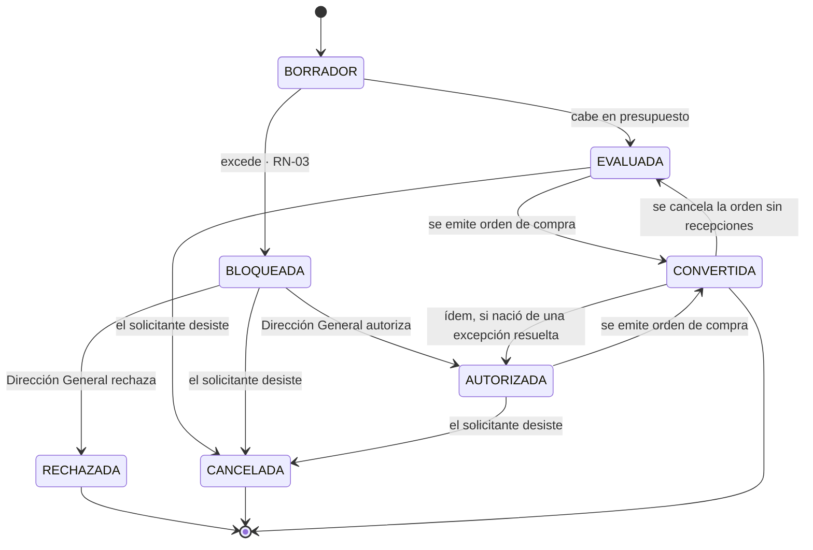

`BLOQUEADA` es un estado persistido, no un error transitorio: es lo que permite contar cuántas veces se intentó sobregirar cada partida.

**`RECHAZADA` y `CANCELADA` no son lo mismo y separarlas importa.** `RECHAZADA` es una decisión de Dirección General sobre una excepción: forma parte del expediente de `RN-04` y responde a *"¿cuántos sobregiros se pidieron y cuántos se negaron?"*. `CANCELADA` es que el solicitante desistió, y no dice nada sobre ninguna autorización. Con un solo estado para las dos cosas, la consulta de excepciones del mes mezclaría negativas de Dirección con requisiciones que nadie llegó a pedir.

**Cancelar es la única forma de liberar presupuesto reservado.** Una requisición `EVALUADA` o `AUTORIZADA` consume desde que se evalúa y **no caduca sola**, así que las tres transiciones a `CANCELADA` son el único desagüe del sistema. Por eso HDU-002 ofrece la consulta de requisiciones evaluadas sin convertir: sin ella la reserva es invisible y nadie sabe qué cancelar.

**`CONVERTIDA` no es terminal.** Cancelar una orden de compra sin recepciones devuelve la requisición a su estado anterior —`EVALUADA` o `AUTORIZADA` según tuviera o no una excepción resuelta detrás— para que pueda volver a convertirse. Volver siempre a `EVALUADA` perdería la autorización de Dirección y obligaría a pedirla otra vez para el mismo gasto ya aprobado.

### Orden de compra

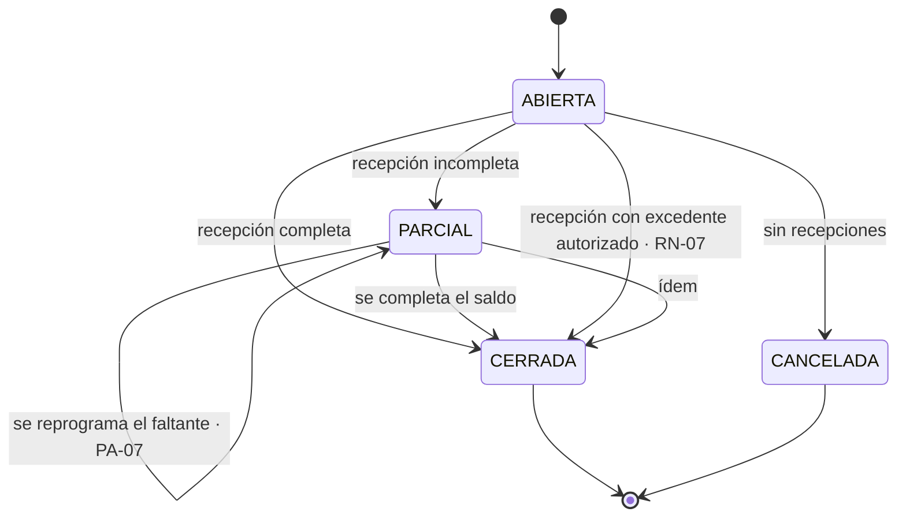

**Una orden solo llega a `CERRADA` cuando se entrega completa** (PA-07). No existe transición de cierre con saldo: si el proveedor no entrega, el faltante se reprograma y la orden permanece en `PARCIAL` indefinidamente. Cancelar solo es posible mientras no haya ninguna recepción.

**Una recepción con excedente autorizado también cierra** (`RN-07`, `PA-16`): el renglón recibe su saldo y el excedente que Dirección General autorizó, queda cubierto, y la orden pasa a `CERRADA` si ningún otro renglón conserva saldo; si lo conserva, sigue en `PARCIAL`. No es un cierre con saldo: es una entrega completa que trajo de más. **Una orden `CERRADA` no admite corrección de sus entradas** (`PA-17`, resuelta el 2026-10-17): bajar lo recibido le devolvería saldo y la reabriría, así que se rechaza con `409` `CONFLICTO` `ESTADO_NO_PERMITE_OPERACION` y no existe transición de `CERRADA` a `PARCIAL`.

### Avance

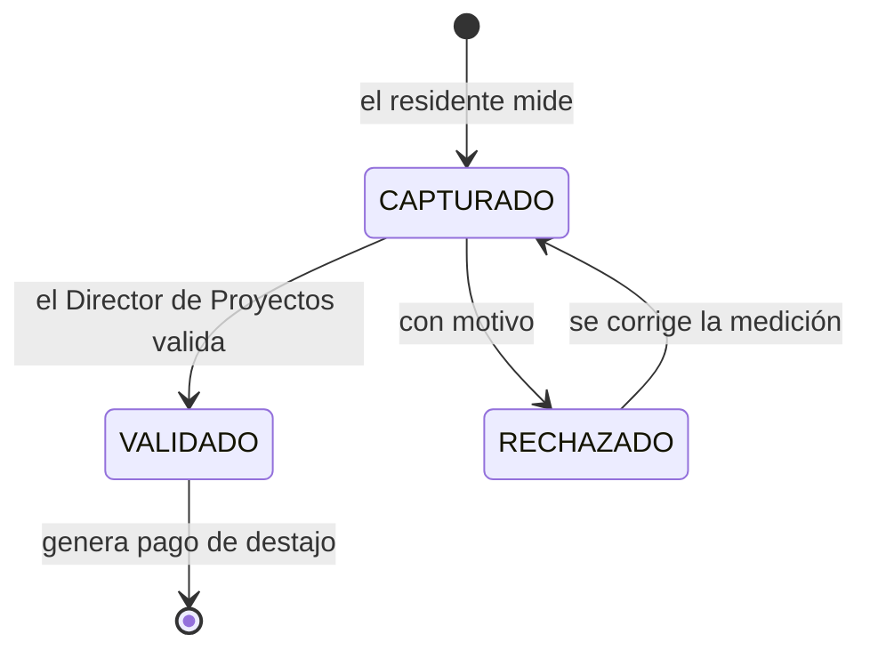

### Pago de destajo

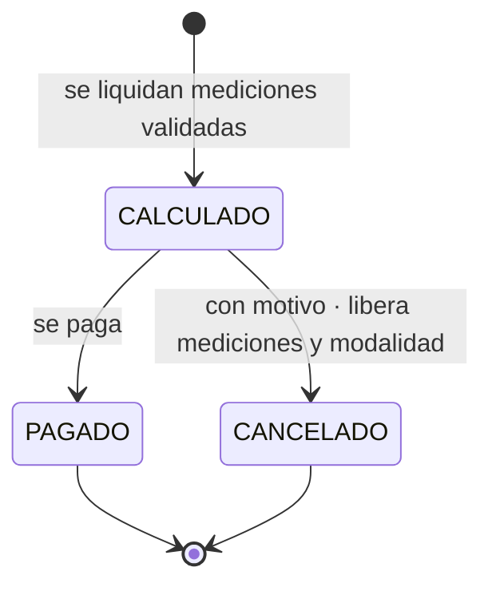

**Cancelar no borra nada.** El pago queda `CANCELADO` con autor, motivo y fecha (invariante 36), sus filas puente pasan a `vigente = false` y las mediciones quedan libres para un pago nuevo (invariante 35). Un pago `PAGADO` no se cancela. *Fase 2.*

### Archivo

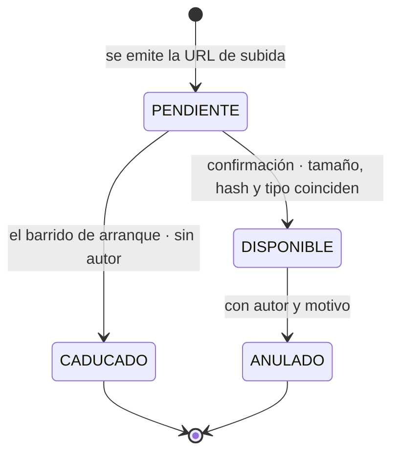

`CADUCADO` y `ANULADO` son finales y distintos: el primero lo pone el sistema cuando una subida no llegó a confirmarse y no tiene autor; el segundo lo pone una persona y exige motivo (invariante 24). Ninguno borra la fila.

### Línea base

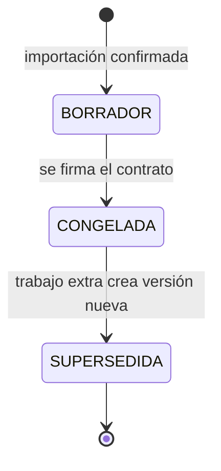

Una línea base `CONGELADA` **nunca vuelve a `BORRADOR`**. Solo puede ser sustituida por una versión posterior, y la anterior se conserva íntegra.

---

## 15. La consulta del semáforo

El entregable del producto se resuelve con una consulta por obra, agrupada por **tipo de partida** (PA-01). Se expresa conceptualmente en una sola pieza para que se lea entera, aunque **no la ejecuta un solo módulo**:

| Pieza | Dueño | Cómo la obtiene `analitica` |
|---|---|---|
| `presupuestado` | `presupuesto` (tablas), leído por `compras` | Interfaz publicada de `compras` |
| `requisiciones_vivas`, `comprometido` | `compras` (tablas suyas) | Interfaz publicada de `compras` |
| `ejercido` de materiales | `almacen`, que implementa el puerto `FuenteEjercido` de `compras` | Interfaz publicada de `compras` |
| `ejercido` de destajo · *fase 2* | `avance`, que implementa el mismo puerto | Interfaz publicada de `compras` |
| `consumido`, `disponible` | `compras` | Interfaz publicada de `compras` |
| `alcance`, `ejecutado`, avance físico | `avance` · *fase 2*; en la fase 1, el adaptador de [ADR-017](adr/20261015-fuentes-simuladas-analitica.md) | Puerto de lectura de `analitica` |
| Nómina por obra | `personal` · *fase 2* | Puerto de lectura de `analitica` |

**`compras` es el dueño del `consumido`, y `analitica` no reescribe sus CTE.** Las obtiene llamando a la interfaz publicada de `compras`, con el rol de solo lectura, así que la definición existe una sola vez y el disponible del tablero es, por construcción, el que aplica `RN-03`.

```sql
-- ═══ compras · interfaz publicada del consumido (RN-03) ═══
WITH presupuestado AS (           -- tope CAPTURADO por Dirección · PA-03 · leído por la interfaz de presupuesto
    SELECT pc.tipo_partida_id, pc.importe_tope AS importe
    FROM presupuesto_control pc
    JOIN linea_base lb ON lb.id = pc.linea_base_id
    WHERE lb.obra_id = :obra_id AND lb.estado = 'CONGELADA'
),
requisiciones_vivas AS (          -- compras · evaluadas o autorizadas, aún sin orden de compra
    SELECT r.tipo_partida_id, SUM(r.importe_solicitado) AS importe
    FROM requisicion r
    WHERE r.obra_id = :obra_id
      AND r.estado IN ('EVALUADA', 'AUTORIZADA')
    GROUP BY r.tipo_partida_id
),
comprometido AS (                 -- compras · ordenado y aún no recibido
    SELECT r.tipo_partida_id,
           SUM(GREATEST(ocr.cantidad_ordenada - ocr.cantidad_recibida, 0)   -- un renglón con excedente no resta
               * ocr.costo_unitario) AS importe
    FROM orden_compra_renglon ocr
    JOIN orden_compra oc ON oc.id = ocr.orden_compra_id
    JOIN requisicion r   ON r.id  = oc.requisicion_id
    WHERE oc.obra_id = :obra_id AND oc.estado IN ('ABIERTA','PARCIAL')
    GROUP BY r.tipo_partida_id
),
-- ─── ejercido: llega por el puerto FuenteEjercido, que declara compras ───
ejercido_materiales AS (          -- lo implementa almacen · directo del libro mayor
    SELECT mi.tipo_partida_id, SUM(mi.importe) AS importe
    FROM movimiento_inventario mi
    WHERE mi.obra_id = :obra_id
      AND mi.tipo IN ('ENTRADA', 'AJUSTE', 'MERMA',
                      'TRASPASO_SALIDA', 'TRASPASO_ENTRADA')
    GROUP BY mi.tipo_partida_id
),
ejercido_destajo AS (             -- lo implementa avance · fase 2 · llega a partida vía la etapa · PA-08
    SELECT ed.tipo_partida_id, SUM(pda.importe) AS importe   -- importe de la fila puente, no del pago
    FROM pago_destajo_avance pda
    JOIN pago_destajo pd  ON pd.id = pda.pago_destajo_id
    JOIN avance a         ON a.id  = pda.avance_id
    JOIN etapa_destajo ed ON ed.id = a.etapa_destajo_id
    WHERE pd.obra_id = :obra_id
      AND pd.estado <> 'CANCELADO'
      AND pda.vigente
    GROUP BY ed.tipo_partida_id
),
ejercido AS (                     -- solo REAL: es el término de consumido
    SELECT tipo_partida_id, SUM(importe) AS importe
    FROM (SELECT * FROM ejercido_materiales
          UNION ALL
          SELECT * FROM ejercido_destajo) fuentes
    GROUP BY tipo_partida_id
),
-- ═══ avance · puerto de lectura de analitica · fase 2 ═══
alcance AS (                      -- DENOMINADOR: m² comprometidos, todas las áreas y etapas
    SELECT ed.tipo_partida_id, SUM(ad.m2_contrato) AS m2
    FROM alcance_destajo ad
    JOIN etapa_destajo ed ON ed.id = ad.etapa_destajo_id
    WHERE ad.obra_id = :obra_id
    GROUP BY ed.tipo_partida_id
),
ejecutado AS (                    -- NUMERADOR: solo lo VALIDADO
    SELECT ed.tipo_partida_id, SUM(a.m2_real) AS m2
    FROM avance a
    JOIN etapa_destajo ed ON ed.id = a.etapa_destajo_id
    WHERE a.obra_id = :obra_id AND a.estado = 'VALIDADO'
    GROUP BY ed.tipo_partida_id
),
avance_fisico AS (
    SELECT al.tipo_partida_id,
           ej.m2 / al.m2 AS porcentaje   -- NULL mientras no haya nada validado
    FROM alcance al
    LEFT JOIN ejecutado ej ON ej.tipo_partida_id = al.tipo_partida_id
    WHERE al.m2 > 0
)
-- ═══ analitica · compone la fila ═══
SELECT tp.id,
       tp.nombre                                              AS partida,
       pr.importe                                             AS presupuestado,
       COALESCE(rv.importe, 0)                                AS requisiciones_vivas,
       COALESCE(cm.importe, 0)                                AS comprometido,
       COALESCE(ej.importe, 0)                                AS ejercido,
       pr.importe - (COALESCE(rv.importe, 0)
                     + COALESCE(cm.importe, 0)
                     + COALESCE(ej.importe, 0))               AS disponible,
       av.porcentaje                                          AS avance,
       CASE WHEN av.porcentaje IS NULL THEN NULL              -- «sin avance medido»
            ELSE COALESCE(ej.importe, 0)                      -- + ejercido_simulado en la fase 1
                 - pr.importe * av.porcentaje
       END                                                    AS desviacion
FROM tipo_partida tp
JOIN presupuestado pr ON pr.tipo_partida_id = tp.id
LEFT JOIN requisiciones_vivas rv ON rv.tipo_partida_id = tp.id
LEFT JOIN comprometido        cm ON cm.tipo_partida_id = tp.id
LEFT JOIN ejercido            ej ON ej.tipo_partida_id = tp.id
LEFT JOIN avance_fisico       av ON av.tipo_partida_id = tp.id;
```

**La columna de desviación es todo el producto.** Compara dinero gastado contra obra realmente construida, no contra el calendario. Una partida al 40 % de avance con el 70 % ejercido sale en rojo aunque falten meses de plazo.

**El color lo decide el servidor, no la consulta ni la interfaz.** Son tres (`PA-18`, resuelta el 2026-10-17): `VERDE` con desviación ≤ 0; `AMARILLO` con desviación positiva y desviación relativa —`desviación ÷ (presupuestado × avance)`— dentro de `obra.umbral_alerta_pct`; `ROJO` por encima del umbral, o con cualquier desviación positiva si la obra no tiene umbral. La alerta de `F7.3` sale con `ROJO`. Con desviación `NULL` no hay color: la fila es `SIN_AVANCE_MEDIDO`, un estado aparte. El corte entre amarillo y rojo es un supuesto sin bloqueo del [PRD §10](01-descripcion-producto.md#10-supuestos-y-preguntas-abiertas): el cliente dio los colores, no el umbral.

Cuatro filas por obra en lugar de ~572. Es lo que cambió `PA-01`, y de paso hizo la consulta trivial de leer. Cada fila expone además `requisiciones_vivas` y `disponible`: son las cifras que Compras necesita para entender un bloqueo antes de que ocurra.

### El avance se divide entre el alcance, no entre lo ya medido

Es el detalle del que depende que la columna de desviación signifique algo, y es fácil equivocarlo.

**El denominador es `alcance_destajo`**: los m² que la obra tiene comprometidos en ese tipo de partida, sumando todas sus áreas y todas sus etapas. Un muro de 100 m² que pasa por `METAL`, `TAPADO` y `PASTA` aporta 300 m² y solo llega al 100 % cuando las tres etapas están validadas.

**Lo que no puede ser el denominador es `SUM(avance.m2_contrato)`.** Sumar los m² de contrato *de las mediciones ya hechas* da el cociente entre lo medido y lo que se esperaba medir — el índice de desviación de volumen, 83.82 ÷ 81.87 ≈ 1.02 en el departamento 212 — y por tanto un avance próximo al 100 % desde la primera medición de la obra. La desviación se calcularía contra el presupuesto entero y una partida recién empezada saldría en verde. Es el mismo dato que F4.7 reporta, y tiene su sitio, pero no es este.

**`porcentaje` es `NULL`, no cero, mientras no haya nada validado.** Un cero haría que `desviacion = ejercido`, que es justo lo que el escenario 9 de [HDU-006](04-historias-usuario.md#hdu-006--semáforo-de-obra) prohíbe: una partida sin medir se marcaría como desviada por todo lo que lleva gastado. El `CASE` propaga el `NULL` a la desviación y la interfaz lo presenta como *"sin avance medido"*, que es distinto de una desviación de cero.

### El consumido de `RN-03`

`RN-03` evalúa contra `disponible = presupuestado − consumido`, con

```text
consumido = requisiciones_vivas + comprometido + ejercido
```

**El semáforo reutiliza esas columnas tal como las calcula `compras`.** No es una consulta paralela: `analitica` las pide a la interfaz publicada de `compras`, y el `ejercido` que entra en la suma es **solo el real**, el que llega por `FuenteEjercido`. Si el tablero y el bloqueo calcularan distinto, el disponible que Compras ve en pantalla no sería el que la regla aplica.

**El ejercido llega por un puerto, y por eso el grafo sigue siendo acíclico.** `compras` declara `FuenteEjercido` en su capa de aplicación; `almacen` lo implementa para materiales (desde TKT-035, sprint 5) y `avance` para destajo (fase 2, TKT-069). Las aristas van de quien implementa a quien declara —`almacen → compras`, `avance → compras`—, nunca al revés. Mientras `almacen` no lo implementa, en los sprints 3 y 4, `compras` usa un adaptador **"cero real"**: no hay entradas, así que el ejercido vale cero y es verdad. El puerto se ejecuta **con la sesión de la transacción en curso**, dentro del bloqueo de [ADR-004](adr/20260918-bloqueo-pesimista-presupuesto.md): un ejercido leído por otra conexión quedaría fuera del bloqueo y podría no ser el estado contra el que la regla decide.

Tres propiedades deliberadas:

**Cada peso se cuenta una sola vez.** Una requisición consume mientras está viva; al convertirse en orden deja de contar como requisición y pasa a contar en `comprometido` como saldo no recibido; al llegar el material deja el saldo y pasa a `ejercido`. Un excedente de recepción autorizado (`RN-07`) entra en el `ejercido` con su movimiento `ENTRADA` y nunca resta del `comprometido`: el `GREATEST` impide que un renglón recibido de más dé saldo negativo. Sumar órdenes y entradas sin restar lo recibido contaría dos veces el mismo material. En el destajo, por la misma razón, se suma el `importe` de cada fila puente y no el `importe_bruto` del pago: un pago que liquida tres mediciones aparecería tres veces en la unión.

**Las requisiciones vivas cuentan, y por eso el bloqueo funciona.** Sin ellas, las dos requisiciones simultáneas de $8,000 contra $12,000 del escenario 9 de HDU-002 pasarían las dos: ninguna habría consumido nada todavía. El bloqueo pesimista serializa las transacciones, pero serializar dos lecturas que ven cero consumido no impide nada.

**La reserva se libera cancelando, nunca por caducidad.** Una requisición evaluada y olvidada retiene presupuesto indefinidamente. Es una decisión consciente, con su disparador de revisión en el [PRD §10](01-descripcion-producto.md#10-supuestos-y-preguntas-abiertas), y su contrapeso es la consulta de requisiciones evaluadas sin convertir que Compras tiene en HDU-002.

**El control por volumen es la misma fórmula con otra unidad**: en lugar de importes, cantidades, contra `explosion_presupuesto.cantidad_presupuestada`. Los renglones de las requisiciones vivas, los saldos de orden y las entradas se agrupan por **`(tipo_partida_id, insumo_id)`**, nunca solo por insumo: el mismo tablero de yeso presupuestado en `MUROS` y en `PLAFONES Y CAJILLOS` son dos bolsas de volumen, y sumarlas dejaría que una partida consumiera el volumen de la otra.

### En la fase 1: lo simulado no toca esta consulta

En la fase 1 no existen `pago_destajo`, `avance`, `alcance_destajo` ni `imputacion_nomina_obra`: nacen en la fase 2 ([PRD §7](01-descripcion-producto.md#7-alcance-mvp-y-evolución)). Las CTE `ejercido_destajo`, `alcance` y `ejecutado` se añaden entonces, y hasta ese momento **el término de destajo del `consumido` vale cero, y es un cero real**.

Las cifras de mano de obra y avance que el semáforo muestra en la fase 1 llegan **fuera de esta consulta**, por un puerto de lectura de `analitica` con tres adaptadores ([ADR-017](adr/20261015-fuentes-simuladas-analitica.md)): `SIMULADO`, admitido solo en `local`, `pruebas` y `demostracion`; `VACIO`, que declara todas sus fuentes `SIN_DATOS` y es **el único admitido en `produccion` durante la fase 1**; y `REAL`, que llega con TKT-069 en el sprint 8. Cuatro reglas fijan cómo conviven con lo real:

- **`ejercido` es solo real**, y es el que entra en el `consumido`. El destajo simulado viaja en su propia columna, **`ejercido_simulado`**, nula salvo con fuente `SIMULADA`. Nunca se suma al `consumido`: si se sumara, una requisición real se bloquearía por un destajo que no existe. El disponible que muestra el semáforo y el que aplica `RN-03` siguen siendo el mismo número.
- **La desviación se calcula con `ejercido + ejercido_simulado`** y lleva **`ilustrativa: true`** si alguna de sus entradas —el destajo o el avance físico— es `SIMULADA`. Sirve para demostrar qué pregunta responde la columna, no para decidir.
- **Las alertas no se emiten con desviación ilustrativa.** `GET /semaforo/alertas` excluye esas filas: una alerta disparada por datos ficticios contra `obra.umbral_alerta_pct` es una falsa alarma con forma de dato.
- **El aviso de cifra parcial sale cuando alguna fuente no es `REAL`**, sea `SIMULADA` o `SIN_DATOS`. La interfaz pinta el ejercido real en su celda y lo simulado en su propia columna marcada, y el letrero de *"datos simulados"* se genera desde `fuentes[]`, no es un texto fijo. La fuente `AVANCE_FISICO` cubre a la vez el alcance y lo ejecutado.

Con el adaptador `REAL` el destajo ya llega en `ejercido` por `FuenteEjercido`, así que `ejercido_simulado` vale nulo y el puerto de `analitica` solo aporta el avance físico y la nómina. TKT-069 retira el adaptador simulado **entero** en el sprint 8: destajo, alcance y avance pasan a `REAL`, y la nómina sale `SIN_DATOS` hasta que TKT-056 la imputa en el sprint 9.

### La nómina va aparte

PA-08 resolvió el destajo: cada etapa pertenece a un tipo de partida, así que su costo llega al semáforo agrupado como el material. **La nómina no.** Un tablaroquero de sueldo fijo trabaja el día en lo que haga falta; exigirle imputar su jornada a una partida produciría un dato inventado.

```sql
-- Mano de obra de nómina: derivada de las jornadas diarias · RN-23
nomina_obra AS (
    SELECT SUM(ino.importe) AS importe
    FROM imputacion_nomina_obra ino
    JOIN nomina_renglon nr ON nr.id = ino.nomina_renglon_id
    JOIN nomina_semana ns  ON ns.id = nr.nomina_semana_id
    WHERE ino.obra_id = :obra_id AND ns.estado IN ('CERRADA','PAGADA')
)
```

Se presenta como **fila propia al nivel de la obra**, marcada como no imputada a partida. Entra en el total, queda fuera de las desviaciones por partida. El cliente lo confirmó como aceptable (PA-10) y lo verifica el escenario 5 de [HDU-006](04-historias-usuario.md#hdu-006--semáforo-de-obra).

**El importe ya no es una estimación.** `imputacion_nomina_obra` reparte el neto de cada empleado en proporción a los días que efectivamente trabajó en cada obra, tomados de `jornada`. Antes de `RN-23` esto era un reparto manual; ahora es un dato derivado.

> Prorratear la nómina entre partidas según el avance produciría una cifra que **parece** precisa sin serlo. Para un producto cuyo propósito es que la dirección confíe en el número, una aproximación silenciosa es peor que un dato declarado como no imputado.

### Índices que la sostienen

| Tabla | Índice |
|---|---|
| `presupuesto_control` | `(linea_base_id, tipo_partida_id)` único |
| `explosion_presupuesto` | `(linea_base_id, tipo_partida_id, insumo_id)` |
| `requisicion` | `(obra_id, tipo_partida_id, estado)` |
| `movimiento_inventario` | `(obra_id, tipo_partida_id, ocurrido_en)` · `(obra_id, tipo_partida_id, insumo_id, ocurrido_en)` para el control por volumen, que agrupa por tipo de partida **e** insumo |
| `orden_compra_renglon` | `(orden_compra_id)` con `cantidad_recibida < cantidad_ordenada` parcial |
| `entrada_almacen` | `(proveedor_id, folio_remision)` único — invariante 29 |
| `avance` | `(obra_id, estado, semana)` · `(etapa_destajo_id, estado)` · `(id, estado)` único, para la clave foránea compuesta del invariante 11 · `(area_id, etapa_destajo_id, cuadrilla_id, semana)` único — invariante 31 |
| `alcance_destajo` | `(area_id, etapa_destajo_id)` único — invariante 22 · `(obra_id)` |
| `etapa_destajo` | `(obra_id, tipo_partida_id, clave)` único — invariante 32 |
| `pago_destajo_avance` | `(avance_id)` único parcial `WHERE vigente` — invariante 35 · `(pago_destajo_id)` |
| `modalidad_pago_semana` | `(cuadrilla_id, semana)` único — invariante 15 |
| `jornada` | `(empleado_id, fecha)` único · `(obra_id, fecha)` |
| `imputacion_nomina_obra` | `(obra_id)` |
| `proveedor` | `(rfc)` único — invariante 28 |
| `bitacora` | `(obra_id, ocurrido_en DESC)` · `(regla_negocio)` parcial donde no es nulo |

> **Cuándo dejará de bastar.** Con 4,900 conceptos y decenas de movimientos diarios, esta consulta responde en milisegundos. El umbral para introducir vistas materializadas está documentado en [ADR-005](adr/20260918-ledger-inventario.md): cuando el libro mayor supere el millón de filas por obra o la consulta exceda 2 s en el percentil 95.

---

## 16. Trazabilidad reglas ↔ esquema

Cada regla del [PRD §8](01-descripcion-producto.md#8-catálogo-de-reglas-de-negocio) y dónde se hace cumplir.

| Regla | Tablas implicadas | Dónde se garantiza |
|---|---|---|
| RN-01 | `linea_base`, `linea_base_concepto`, `explosion_presupuesto` | Copia física + índice único parcial + disparador de inmutabilidad |
| RN-02 | Todas las de movimiento | `NOT NULL` en `obra_id` y en `requisicion.tipo_partida_id` |
| RN-03 | `presupuesto_control`, `explosion_presupuesto`, `requisicion`, `solicitud_autorizacion`, `bitacora` | Dominio + bloqueo de fila en transacción sobre las dos tablas de presupuesto · `consumido` definido en §15, **calculado por `compras`** con el ejercido del puerto `FuenteEjercido` y compartido con el semáforo por la interfaz de `compras` · volumen por `(tipo_partida_id, insumo_id)` · la recaptura de un tope se asienta con esta misma regla |
| RN-04 | `bitacora`, `solicitud_autorizacion` | Escritura en la misma transacción + permisos + `CHECK` de motivo · un `403` autenticado se asienta como `DENEGAR` en transacción propia |
| RN-05 | `entrada_almacen.folio_remision` | `NOT NULL` + `UNIQUE (proveedor_id, folio_remision)` — invariante 29 |
| RN-06 | `orden_compra_renglon`, `entrada_renglon`, `reprogramacion_entrega` | Estado derivado de cantidades · sin transición de cierre con saldo |
| RN-07 | `orden_compra_renglon`, `entrada_renglon`, `solicitud_autorizacion` | `CHECK (cantidad_recibida <= cantidad_ordenada + cantidad_excedente_autorizada)` · la autorización `EXCEDE_ORDENADO` guarda renglón y cantidad — invariante 2 · una entrada la consume una sola vez — invariante 38 |
| RN-08 | `traspaso`, `movimiento_inventario` | Dos movimientos en una transacción |
| RN-09 | `merma`, `archivo` | `NOT NULL` en motivo y responsable · la evidencia es un adjunto con tipo verificado y hash, no una cadena ([§12](#12-archivos-adjuntos)) |
| RN-10 | `avance`, `pago_destajo_avance` | Estado `VALIDADO` + clave foránea compuesta — invariante 11 · una medición por área, etapa, cuadrilla y semana — invariante 31 · un solo pago vigente por medición — invariante 35 |
| RN-11 | `pago_destajo`, `obra.retencion_destajo_pct` | Cálculo en dominio con porcentaje por obra |
| RN-12 | `pago_destajo.fondo_garantia_importe`, `fondo_garantia` | Retención en cada pago desde la fase 2 (`PA-21`) · liberación con `CHECK` sobre las dos banderas — invariante 12 · v1.1 |
| RN-13 | `credito_empleado`, `descuento_nomina` | `CHECK (saldo >= 0)` + `CHECK` de coherencia con el estado + descuento semanal amortizable — invariante 34 |
| RN-14 | `pago_nomina`, `pago_nomina_detalle` | Restricción diferida de suma |
| RN-15 | `proveedor.tope_consignacion`, `consignacion` | Dominio + `solicitud_autorizacion` · v1.1 |
| RN-16 | `anticipo_proveedor`, `amortizacion_anticipo` | Dominio · v1.1 |
| RN-17 | `proveedor.dia_corte`, `factura_proveedor.semana_corte` | Configuración por proveedor · v1.1 |
| RN-18 | `linea_base.version`, `trabajo_extra` | Versionado · v1.1 |
| RN-19 | `trabajo_extra.requiere_licitacion` | Dominio con umbral configurable · v1.1 |
| RN-20 | *(fuera de MVP)* | Requiere control de cobranza |
| RN-21 | `movimiento_inventario`, `pago_destajo_avance`, `imputacion_nomina_obra` | Materiales y destajo entran en `ejercido` por `FuenteEjercido`; la nómina, en la fila de obra no imputada a partida |
| RN-22 | `modalidad_pago_semana`, `cuadrilla_empleado` | `UNIQUE (cuadrilla_id, semana)` por jueves de corte — invariante 15 · el rechazo es solo de la cuadrilla en conflicto (`PA-20`) · un empleado en una sola cuadrilla a la vez — invariante 33 |
| RN-23 | `jornada`, `nomina_semana`, `imputacion_nomina_obra` | `UNIQUE (empleado_id, fecha)` — invariante 16 · `CHECK` de viernes a jueves — invariante 18 · semana de destajo de jueves a miércoles, identificada por su jueves de corte — invariante 37 · reparto derivado, no estimado · 6 días por semana en `empresa.dias_semana_laboral` (`PA-22`) |
| RN-24 | `explosion_presupuesto.rendimiento_congelado`, `rendimiento_observado` | Tablas separadas: ninguna escribe sobre la otra — invariante 19 |
| RN-25 | `obra.iva_acreditable`, `apu_cargo` | Configuración por obra. **`iva_acreditable = false` significa que el IVA es costo y el cargo `IVA` permanece dentro del precio unitario**; con `true` el IVA se recupera y no forma parte del costo. La regla está redactada en negativo en el PRD, así que conviene leer el booleano dos veces antes de implementarlo |
